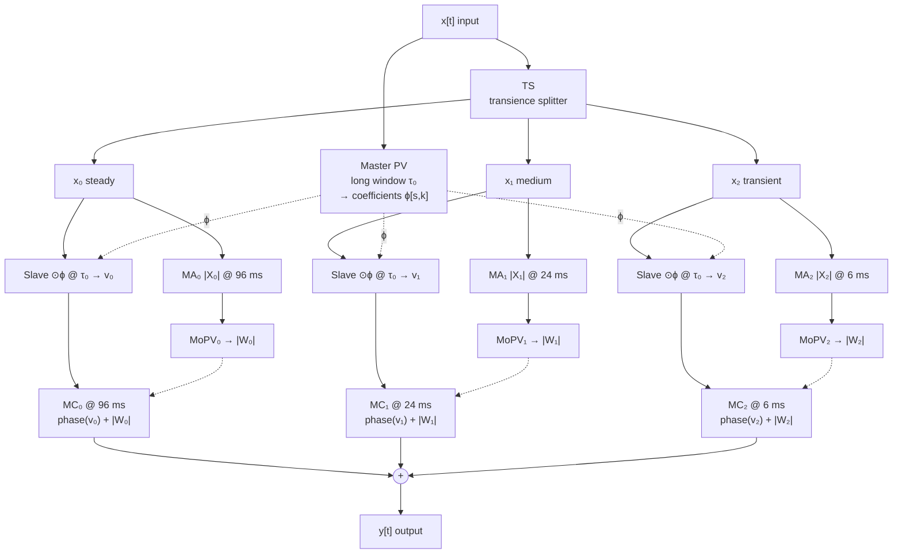

# Audio Time Stretching with an Adaptive Multiresolution Phase Vocoder — Paper Analysis

> **Paper:** Nicolas Juillerat and Béat Hirsbrunner, *"Audio Time Stretching with an Adaptive Multiresolution Phase Vocoder"*, IEEE ICASSP 2017, New Orleans, pp. 716–720. University of Fribourg, Switzerland.
> **PDF (authors' copy):** https://www.pitchtech.ch/Confs/ICASSP2017/0000716.pdf
> **Companion page (audio examples, Java tool):** https://www.pitchtech.ch/Confs/ICASSP2017/index.html
> **Semantic Scholar:** https://www.semanticscholar.org/paper/4d09b84a2c93f73e3f68e8cb7eb9a4c9d7c05751
> **Third-party C++ reimplementation:** https://github.com/jatinchowdhury18/time-stretcher (see §11 before using it)
> **Analysed on:** 2026‑10‑10. Experiments run on Apple M2 against Signalsmith Stretch `1.3.2`.
> **Companion document:** [signalsmith-stretch-analysis.md](signalsmith-stretch-analysis.md). This paper targets two limitations listed there in §11 ("Single resolution", "No explicit transient handling").

---

## Table of Contents

1. [TL;DR](#1-tldr)
2. [Background you need first](#2-background-you-need-first)
3. [The problem and the paper's three ideas](#3-the-problem-and-the-papers-three-ideas)
4. [Related work, as the paper frames it](#4-related-work-as-the-paper-frames-it)
5. [The algorithm, block by block](#5-the-algorithm-block-by-block)
6. [Why it works: the key arguments](#6-why-it-works-the-key-arguments)
7. [Consistency: the 3 dB noise problem (and our measurement)](#7-consistency-the-3-db-noise-problem-and-our-measurement)
8. [Further improvements proposed by the authors](#8-further-improvements-proposed-by-the-authors)
9. [Results and evaluation](#9-results-and-evaluation)
10. [Critical assessment](#10-critical-assessment)
11. [Notes on the public C++ reimplementation](#11-notes-on-the-public-c-reimplementation)
12. [Pseudocode (offline, faithful to the paper)](#12-pseudocode-offline-faithful-to-the-paper)
13. [Applying it to Signalsmith Stretch / live-trax](#13-applying-it-to-signalsmith-stretch--live-trax)
14. [Glossary](#14-glossary)
15. [Reference map](#15-reference-map)

---

## 1. TL;DR

- **Problem.** A phase vocoder uses one window length, so it must choose between frequency resolution (clean tones) and time resolution (sharp drums). Long windows smear transients; short windows make tones rough.
- **Idea.** Split the signal into **P layers by degree of transience**, in both time and frequency. Then:
  1. compute the **phase** for every layer with **one long-window phase vocoder**, so all layers stay phase-coherent with each other;
  2. compute the **magnitude** for each layer at **its own window length** (long for steady, short for transient);
  3. **combine** them: keep each layer's coherent phase, replace its smeared magnitude with the sharp one, and sum the layers.
- **Why it's clever.** Earlier multiresolution methods broke phase coherence between resolutions, or needed about 50× the CPU to repair it. Here the phase is single-resolution by construction, so coherence is free. Only the magnitude is multiresolution.
- **Cost.** The authors report **4–5× the CPU of a plain phase vocoder** (P = 3, Java implementation).
- **Bonus.** The final "magnitude correction" step also fixes the **level loss of noise-like sounds** that every phase vocoder has (up to 3 dB). We measured this loss in Signalsmith Stretch: **0.9 dB at 1.5×, 2.5 dB at 3×** (§7).
- **Limits.** Offline only, informal evaluation, an under-specified transience splitter, and transients sound unnatural beyond 2× because they are *stretched*, not *shifted*.

---

## 2. Background you need first

### 2.1 STFT and the time–frequency trade-off

The phase vocoder works on the **short-time Fourier transform** (STFT): it cuts the signal into overlapping windowed blocks of length *N* and FFTs each block.

| Window τ = N / fs | Bin spacing at 44.1 kHz | Good for | Bad for |
|---|---|---|---|
| ~93 ms (N = 4096) | 10.8 Hz | Separating close partials, bass, sustained chords | Transients are spread across the whole 93 ms |
| ~23 ms (N = 1024) | 43 Hz | Compromise | Neither extreme |
| ~6 ms (N = 256) | 172 Hz | Drum hits, consonants, attacks | A 110 Hz bass note and its harmonics fall into the same bins |

You can't have both in one window. This is the Gabor/Heisenberg limit, and it's the whole motivation for the paper.

### 2.2 How a phase vocoder stretches time

1. Analyse at hop **Ra** (analysis hop).
2. For each bin, estimate the true frequency from the phase change between frames.
3. Advance the output phase as if the hop were **Rs** (synthesis hop), where **α = Rs / Ra** is the stretch factor.
4. Inverse-FFT and overlap-add at hop Rs.

Magnitudes are kept. Phases are rebuilt so that each partial continues smoothly ("horizontal" coherence).

### 2.3 Phase locking (Laroche & Dolson, 1999)

A plain phase vocoder treats each bin independently. The bins around one spectral peak then drift apart in phase, which causes **phasiness**: a reverberant, "underwater" sound. **Scaled phase locking** finds peaks and locks the surrounding bins to the peak's phase ("vertical" coherence). The paper uses this vocoder **as a black box** for its phase computation.

### 2.4 Transient smearing

A drum hit is a short burst. In a long window it occupies a few milliseconds of a 93 ms block. Its timing is encoded only in the **phase slope across frequency**. Horizontal phase propagation destroys that slope, so after resynthesis the hit's energy spreads over the whole window. You hear **pre-echo** (energy before the hit) and a softened attack.

### 2.5 Consistency

Not every set of STFT frames corresponds to a real signal. Frames that overlap must agree on the shared samples. A modified STFT that violates this is **inconsistent**. Overlap-add then partially cancels it, mostly for noise, whose phases are random (Griffin & Lim, 1984). This becomes important in §7.

---

## 3. The problem and the paper's three ideas

The paper's introduction says its method differs from earlier phase-vocoder transient handling in three ways:

| # | Idea | What it replaces | Benefit |
|---|---|---|---|
| 1 | **Detect transience in time *and* frequency** | Time-only onset detection (a whole frame is "a transient") | A hi-hat in the highs does not disturb a sustained bass note in the lows |
| 2 | **Several degrees of transience, not a binary switch** | Transient / not-transient flag | A weak transient over a pad gets an intermediate resolution, which keeps the transient without damaging the pad |
| 3 | **Multiresolution for magnitude only; single resolution for phase** | Mixing outputs of several resolutions ("mixer of coefficients") | Phase coherence between layers is guaranteed by construction |

The intuition for idea 3, from Driedger & Müller [7]: **phase matters mostly for steady sounds**. **Transients are defined by fast magnitude changes** and carry little useful phase information. So phase can come from the long window, and only magnitude needs fine time resolution.

You can't process phase alone, because a signal needs both. The trick: process **both** at one resolution first, then **overwrite the magnitude** using a separate multiresolution, magnitude-only pass.

---

## 4. Related work, as the paper frames it

| Approach | Ref | How transients are handled | Paper's criticism |
|---|---|---|---|
| Transient **shifting** | Nagel & Walther 2009 [2] | Copy the transient unchanged; stretch only the rest | Works in time only: steady sounds at the same moment are treated as transients. Sounds "hashed". |
| **Phase reset** at onsets | Röbel 2003 [3] | Reinitialise phases to the input's at transients | Same time-only issue |
| Shift + reset | Bonada 2000 [4] | Both | Same |
| **Mixer of coefficients** | Lukin & Todd 2006 [5] | Run several resolutions; mix STFT coefficients by local transience | Fine for phase-preserving effects (denoising, centre extraction). For time stretching the resolutions' phases disagree, which gives glitches around transients. |
| **Multi-scale STFT with phase locking** | Juillerat et al. 2008 [6] (main author's earlier work) | Adds steps that lock phases across resolutions | High quality, but needs very large overlap: **~50× slower** than a phase vocoder |
| **PV for steady + time-domain OLA for transients** | Driedger & Müller [7] (HPSS-based TSM) | Harmonic/percussive separation; stretch each with a suitable method | Handles time and frequency, but supports only two classes, not degrees of transience |
| **Pyramidal resolution** | [4], [8] | Fixed: shorter windows for high frequencies | No signal analysis. Not effective against transient smearing when used alone. |
| Other models | [9] sines+transients+noise; [10] nonstationary Gabor frames (Liuni, Röbel); [11] wavelet packets | Different representations | Mentioned for completeness only |

The paper sits between [6], which is high quality but slow, and [7], which is fast but binary. It keeps [6]'s quality claim at about one tenth of the cost.

---

## 5. The algorithm, block by block

### 5.1 Notation

| Symbol | Meaning |
|---|---|
| `x[t]` | Mono input signal |
| `P` | Number of transience layers (paper uses **P = 3**) |
| `x_p[t]`, p = 0…P−1 | Layer p. `x_0` = steadiest, `x_{P−1}` = most transient. **Σ x_p = x** |
| `N`, `Ra`, `Rs` | FFT size, analysis hop, synthesis hop. α = Rs/Ra |
| `τ = N/fs` | "Resolution" (window duration) |
| `X[s,k]` | STFT, frame s (time t = s·Ra), bin k (frequency k·fs/N) |
| `ɸ_{s,k}` | Complex per-bin coefficient produced by the master PV: `V[s,k] = X[s,k]·ɸ_{s,k}` |
| `v_p[t]` | Layer p after the master–slave PV (coherent phase, smeared magnitude) |
| `|W_p[s,k]|` | Layer p's stretched magnitude at its own resolution (sharp, no phase) |
| `y_p[t]` | Layer p after magnitude correction; output `y = Σ y_p` |

### 5.2 Workflow (Figure 1 of the paper)



Solid lines carry time-domain signals and dotted lines carry spectra. The middle column (MS-PV) is **single resolution**. The MA → MoPV → MC chains are **multiresolution**.

### 5.3 TS: Transience Splitting

- **Input:** `x[t]`. **Output:** P time-domain layers with `Σ x_p[t] = x[t]` (an exact, additive split).
- **How (paper):** "a cascade of transient extractors". Each extractor uses a **lower threshold** than the previous one and passes its non-transient remainder on. The first extractor pulls out the strongest transients (`x_{P−1}`), the next pulls weaker ones, and the final remainder is `x_0`.
- The split is in **time and frequency**: an extractor works on STFT bins, so one moment can be transient in the highs and steady in the lows.
- **The detector itself is not described.** It "is based on previous work by the main author [6]", the 2008 multi-scale STFT paper. Alternatives cited: Daudet's review [12], NMF-based percussive/harmonic separation [13], and **FitzGerald's median-filter HPSS [14]**. The authors list "other transience splitting schemes" as future work.
- **A practical P = 3 split** that the paper doesn't mention: Driedger's **harmonic / residual / percussive** extension of median-filter HPSS. It uses a separation factor β and gives three additive layers, which map naturally to steady / intermediate / transient. You could also cascade HPSS with decreasing mask thresholds, which is what the paper describes in spirit.

### 5.4 MA: Magnitude Analysis

- Each layer gets an STFT **at its own resolution**, keeping only magnitudes `|X_p[s,k]|`.
- Paper's example for P = 3: **τ = 96 ms, 24 ms, 6 ms** (a ratio of 4 between neighbours). At 44.1 kHz the nearest powers of two are N = 4096, 1024, 256.
- Hops are **not specified**. A 4× overlap (hop = N/4) is a reasonable default.

### 5.5 MS-PV: Master–Slave Phase Vocoder

- **Master:** a normal phase vocoder (with scaled phase locking [1]) runs on the **full mix `x[t]`** at the long resolution τ₀. Whatever it does internally, its result can be written as one complex multiplier per bin: `V[s,k] = X[s,k]·ɸ_{s,k}`.
- **Slaves:** each layer is STFT'd **with the same long window and hop**, multiplied bin by bin by the **same** ɸ, and resynthesised: `V_p[s,k] = X_p[s,k]·ɸ_{s,k}` → `v_p[t]`.
- That's P + 1 STFTs, all at τ₀. The master's own output `v[t]` is **never used**; only its ɸ is.
- **Guarantee:** STFT and ISTFT are linear, and Σ x_p = x. So `Σ v_p = ISTFT(Σ X_p·ɸ) = ISTFT(X·ɸ) = v`. The layers are phase-coherent fragments of one normal phase-vocoder output. The paper writes `v ≈ Σ v_p`; in exact arithmetic with an exact split it is equality.
- **This is the standard stereo trick.** Phase vocoders already keep L/R coherent by computing phases on a mono aggregate (L+R) and applying them to both channels. The paper's contribution is to apply it to **transience layers** instead of channels.

### 5.6 MoPV: Magnitude-only Phase Vocoder

- Stretches each `|X_p|` in time at that layer's own resolution and gives `|W_p[s,k]|`.
- "Trivially implemented by using different analysis and synthesis hop sizes." Input frames are read at hop `Ra_p = Rs_p/α` and placed at hop `Rs_p`. With no phase to propagate, frame s of the output magnitude is frame s of the input magnitude, re-timed.
- **Consequence:** a transient spanning d ms of input covers about d·α ms of output frames. Transients are **stretched**, not shifted. This matters in §9.

### 5.7 MC: Magnitude Correction

For each layer, STFT `v_p` **at that layer's resolution τ_p** and replace the magnitude:

```
Y_p[s,k] = |W_p[s,k]| · e^{ i·arg(V_p[s,k]) }       (V_p = STFT of v_p at τ_p)
y_p[t]   = ISTFT(Y_p)
y[t]     = Σ_p y_p[t]
```

- `v_2` (most transient) is badly smeared because it went through a 96 ms vocoder. Re-analysed at 6 ms, its smeared energy sits in the frames before and after the true onset. `|W_2|` is near zero in those frames and large at the onset. Replacing the magnitude **erases the smear** and keeps `v_2`'s phase, which is coherent with the other layers.
- `v_0` (steady) is only "re-magnitude'd" at the same long resolution. This looks useless but isn't (see §7).
- **Implicit requirement (not stated in the paper):** the MC STFT grid for layer p must match the MoPV output grid for layer p, with the same window, the same hop `Rs_p`, and frames aligned on the output timeline. Otherwise frame s of `V_p` and frame s of `W_p` describe different moments.

### 5.8 Worked example (stretch α = 1.5, 44.1 kHz, P = 3, 4× overlap)

| Stage | Layer 0 (steady) | Layer 1 (medium) | Layer 2 (transient) |
|---|---|---|---|
| MA window / hop Ra | 4096 / 683 | 1024 / 171 | 256 / 43 |
| MoPV output hop Rs | 1024 | 256 | 64 |
| MS-PV (all layers) | 4096 window, Ra = 683, Rs = 1024 | same | same |
| MC window / hop | 4096 / 1024 | 1024 / 256 | 256 / 64 |
| What MC changes | Restores noise level (§7) | Partial de-smearing | Full de-smearing |

The fractional hops (1024/1.5 = 682.67) must be accumulated as fractional read positions, not rounded once. Otherwise the layers drift apart in time.

---

## 6. Why it works: the key arguments

1. **Coherence across layers is structural, not repaired.** Every `v_p` gets the same per-bin phase rotation (ɸ). Two layers that overlap in a bin stay in the same phase relationship as in the input. MC never touches phase, so this survives to the output. Compare the mixer-of-coefficients approach [5]: there each resolution builds its own phase trajectory, and switching between them causes discontinuities.
2. **Magnitude can be multiresolution freely.** Magnitude has no phase "memory", so mixing magnitudes from different windows creates no discontinuity. The worst case is a slightly inconsistent STFT, which overlap-add smooths out.
3. **Transience controls the resolution, continuously.** A weak transient over a pad goes to layer 1 (24 ms). That is enough to keep the attack audible, and the pad (in layer 0) still gets 96 ms resolution. A binary system must choose one or the other for the whole moment.
4. **Magnitude correction is one Griffin–Lim iteration.** STFT of a signal, swap in a target magnitude, keep the phase, ISTFT: that is exactly one step of Griffin–Lim phase reconstruction, initialised with the vocoder's phases. This explains both the de-smearing and the noise-level fix. The paper doesn't make this connection.

---

## 7. Consistency: the 3 dB noise problem (and our measurement)

**Paper's claim (§5).** If MA₀/MoPV₀/MC₀ are removed, **noise-like (atonal) signals lose up to 3 dB**, while tonal signals keep their level. So the tonal/noise balance of a mix shifts. The cause is that noise phases are chaotic, so horizontal phase propagation produces an inconsistent STFT, and overlap-add partly cancels it. MC₀ fixes this "even for the degenerated case of P = 1".

**Why MC₀ fixes it.** After the vocoder, `v_0` has lost energy. Re-analysing `v_0` gives phases that are **consistent with a real signal**. Putting the *original* (un-cancelled) magnitudes back onto those consistent phases and resynthesising therefore overlap-adds with far less cancellation, and the level comes back.

**Our measurement on Signalsmith Stretch 1.3.2** ([bench/noise-level.cpp](bench/noise-level.cpp); 10 s mono, 48 kHz, `presetDefault`, RMS over the middle section):

| Stretch | White noise level | Sine level | Noise vs. tone |
|---|---|---|---|
| 0.75× | −1.09 dB | 0.00 dB | **−1.09 dB** |
| 1.00× | 0.00 dB | 0.00 dB | 0.00 dB |
| 1.25× | −0.75 dB | 0.00 dB | −0.75 dB |
| 1.50× | −0.87 dB | 0.00 dB | −0.87 dB |
| 2.00× | −1.34 dB | −0.05 dB | −1.29 dB |
| 3.00× | −2.60 dB | −0.07 dB | **−2.53 dB** |
| 4.00× | −3.08 dB | −1.04 dB | −2.04 dB |

**Reading:** Signalsmith has the problem the paper describes. Noise (cymbals, breath, reverb tails, room tone) gets about 1 dB quieter relative to tones in the normal range, and about 2.5 dB quieter at 3×. Above 2×, Signalsmith randomises phases on purpose, so the tonal level also drops at 4×. A P = 1 version of the paper's MC step is a cheap, self-contained fix to try (§13.3).

To reproduce:
```bash
clang++ -std=c++11 -O3 -I <signalsmith-stretch>/include -I <dir containing signalsmith-linear> bench/noise-level.cpp -o bench/noise-level
```

---

## 8. Further improvements proposed by the authors

| § | Improvement | Status in the paper | Notes |
|---|---|---|---|
| 6.1 | **Stereo / multichannel** | Implemented in the Java tool | Duplicate everything per channel **except the MS-PV**. One master runs on L+R (or a better aggregate) and drives all 2P slaves (`x_p^L`, `x_p^R`). This keeps coherence across layers *and* channels. Extends to surround. |
| 6.2 | **Pyramidal resolutions** | Preliminary tests, "audible improvements". Samples on the companion page; not in the Java tool. | Complementary: strong transients are handled by the adaptive split, and weak ones the detector misses (e.g. phase-only transients) are handled by shorter windows at high frequencies |
| 6.3 | Phase reset at transients [3] | Under investigation | Could help at extreme ratios |
| 6.3 | Phasiness reduction [16], [17] | Under investigation | Followed up in Juillerat, *"Audio Time Stretching with Controllable Phase Coherence"*, AES 142, 2017 (samples on the companion page) |
| 6.3 | Better noise handling [18], [19] | Under investigation | E.g. Liao/Röbel/Su on stretching Gaussian noise |
| 6.3 | Other transience splitters [12]–[14] | Under investigation | Daudet review, NMF, median-filter HPSS |

---

## 9. Results and evaluation

**What the paper shows**
- Java implementation, **P = 3**.
- **One figure**: spectrograms of a polyphonic excerpt (a), a phase vocoder at 1.5× (b), and the proposed method at 1.5× (c). Vertical lines (transients) are sharp in (c) and smeared in (b), even where tones and noise sit at the same time.
- **"Informal listening tests"**: transients preserved, non-transient components unaffected, even when both happen at once.
- **Speed:** 4–5× slower than a plain phase vocoder. Their earlier [6] was ~50×.

**Comparisons (companion page, 1.5×, five excerpts):** plain PV with scaled phase locking, the proposed method, Rubber Band (the 2016 version, which shifts transients and resets phase), and iZotope Radius (shipped in Adobe Audition CS6). The authors' own observations:
- *Pop excerpt* (a vocal over percussion): time-only methods make a long sung vowel sound **"hashed"**, because co-occurring percussion forces the vowel to be processed like a transient. Detection in time and frequency avoids this.
- *Classical excerpt* (string pads with "hidden" transients): binary methods make long string notes sound hashed. Multiple degrees of transience avoid this.
- Also 0.7×, 1.1×, and 2.1× versions against Radius.

**Limitations the authors admit**
- At **α < 0.5 or α > 2**, transients "sometimes sound unnatural" **because they are stretched like the rest of the signal**. Methods that shift transients may win there.
- For **pitch shifting by stretch + resample**, the method *always* preserves transient duration, because the resampling undoes the transient's stretch. This makes it well suited to pitch shifting.

**What is missing**
- No objective metrics (PEAQ/ODG, ViSQOL, onset sharpness), no formal listening test (MUSHRA), no statistics.
- No parameter study: P, the τ values, hops, and detector thresholds are all fixed or unspecified.
- Only one stretch factor in the paper itself (1.5×).

---

## 10. Critical assessment

### ✅ Strengths
| Area | Assessment |
|---|---|
| **Core insight** | Separating "where phase comes from" (one resolution) from "where magnitude comes from" (many resolutions) is simple and general. It works with any phase vocoder as the master: Laroche–Dolson, PVDR, or Signalsmith's own predictor. |
| **Coherence by construction** | Linearity guarantees Σ v_p = v. No phase-repair step. |
| **Soft decisions** | Graded transience across time and frequency avoids the "hashed" artefacts of binary, time-only detectors. |
| **Free consistency fix** | Even P = 1 improves the tonal/noise balance (§7, confirmed in Signalsmith). |
| **Building blocks** | Only STFTs, one phase vocoder, a splitter, and per-bin arithmetic. No iterative optimisation, no learned model. |
| **Pitch-shift friendly** | Stretch + resample keeps transient durations exact. |

### ⚠️ Weaknesses and open questions
| Area | Issue |
|---|---|
| **Transience splitter is a black box** | It's the component that decides quality, and the paper defers it to [6]. Reproducing the results needs a substitute (HPSS / HPR), which may behave differently. |
| **Unspecified parameters** | MA/MoPV/MC hops, overlap, window type, detector thresholds, how layer resolutions scale with sample rate |
| **MC is a single projection** | Replacing magnitude once gives an inconsistent STFT, so the output's real magnitude ≠ `|W_p|`. Extra Griffin–Lim iterations would tighten this at extra cost. Not discussed. |
| **Transients are stretched** | Above 2× this sounds unnatural. A hybrid (shift layer P−1, stretch the others) is the obvious extension, and the layered structure makes it easy. |
| **Cross-layer bleed** | If the splitter leaks steady energy into the transient layer, MC₂ imposes 6 ms-resolution magnitudes on it, which brings back the roughness of short windows (see §13.1 for how bad that is). |
| **Real time not addressed** | Latency is the sum of the splitter's look-ahead (median filters need future frames), the master PV window, and the MC window. Probably hundreds of ms (§13.4). |
| **Time-varying stretch not addressed** | The MoPVs must follow exactly the master's time map. Easy offline, fiddly in streaming. |
| **Evaluation** | Informal. The companion audio is the only real evidence. |
| **Cost** | 4–5× a phase vocoder is acceptable offline. For many real-time voices it is a real budget item. |

---

## 11. Notes on the public C++ reimplementation

[`jatinchowdhury18/time-stretcher`](https://github.com/jatinchowdhury18/time-stretcher) (BSD-3) says it is based on this paper plus FitzGerald's HPSS. It reads well as a **sketch**, but it is **not a faithful or correct reference**. From reading `src/stretch.cpp` and `src/hpss.cpp`:

| Item | What the code does | Consequence |
|---|---|---|
| Layers | **P = 2** (harmonic / percussive via median-filter HPSS), long window 100 ms, short 5 ms | No "intermediate" layer, so idea 2 of the paper is absent |
| Master PV | Basic phase propagation, **no phase locking** | Phasier than the paper's master |
| **Phase units bug** | `phase_propagation` returns phases in **cycles** (∈ [0, 1)), but they are passed straight to `std::polar(…, phase)`, which expects **radians** | Phases are wrong by a factor of 2π. Layers stay coherent with each other (they share the error), but the master's phase trajectory isn't a valid vocoder output. |
| **HPSS bug** | In `median_filter_perc`, the kernel window is `med_vec.begin() + i` (frame index) instead of `+ h` (bin index) | The percussive estimate for each frame uses the same window for every bin, so the split is not a proper vertical median |
| MoPV | Overlap-adds the layer's frames with their **original phases** at the synthesis hop, then re-analyses that signal | Not magnitude-only: overlapping frames interfere, so `|W|` isn't the stretched input magnitude |
| Level | Peak-normalises each layer and the output to the input's peak | Hides level errors (including the §7 effect) instead of fixing them |

If you need a starting point, use its structure but rewrite it from the pseudocode in §12.

---

## 12. Pseudocode (offline, faithful to the paper)

This is pseudocode for reading, not tested code. `stft(x, N, hop)` returns complex frames, and `istft(S, N, hop)` overlap-adds them with a normalised synthesis window. Positions are fractional to avoid drift.

```python
def adaptive_mr_stretch(x, fs, alpha, taus=(0.096, 0.024, 0.006), overlap=4):
    P = len(taus)
    Ns = [pow2_near(t * fs) for t in taus]        # 4096, 1024, 256 @ 44.1 kHz
    Rs = [N // overlap for N in Ns]               # synthesis hops (output timeline)
    Ra = [r / alpha for r in Rs]                  # fractional analysis hops (input timeline)

    # 1. Transience splitting: additive, time-frequency, graded
    layers = transience_split(x, fs, P)           # sum(layers) == x; layers[0] steadiest

    # 2+4. Magnitude analysis + magnitude-only PV at each layer's own resolution
    W = [abs(stft_at_positions(layers[p], Ns[p], hop=Ra[p])) for p in range(P)]
    #     frame s was read at input position s*Ra[p] and belongs at output position s*Rs[p]

    # 3. Master-slave phase vocoder at the longest resolution
    X  = stft_at_positions(x, Ns[0], hop=Ra[0])
    V  = phase_vocoder_with_phase_locking(X, Ra[0], Rs[0])   # black box [Laroche-Dolson]
    phi = V / (X + eps)                                       # per-bin complex coefficients
    v = [istft(stft_at_positions(layers[p], Ns[0], hop=Ra[0]) * phi, Ns[0], Rs[0])
         for p in range(P)]                                   # sum(v) == istft(V)

    # 5. Magnitude correction at each layer's own resolution (on the output grid)
    y = 0
    for p in range(P):
        Vp = stft(v[p], Ns[p], hop=Rs[p])                     # same grid as W[p]
        n  = min(len(Vp), len(W[p]))
        Yp = W[p][:n] * exp(1j * angle(Vp[:n]))
        y += istft(Yp, Ns[p], Rs[p])
    return y
```

**Stereo (§6.1):** run `transience_split` and the MA/MoPV/MC chains per channel, compute `phi` **once** from `L + R`, and apply it to every layer of both channels.

**Checks worth automating:**
1. `sum(layers) == x` (the splitter is exact).
2. With α = 1 and MC skipped, `sum(v) ≈ x`.
3. With α = 1, `y ≈ x` (MC is close to identity).
4. Noise-vs-tone level at 1.5× and 3× (the §7 bench).
5. Pre-echo and tone purity (the §13.1 benches).

---

## 13. Applying it to Signalsmith Stretch / live-trax

### 13.1 Does Signalsmith need this? Measurements

Signalsmith already does something the paper's baseline doesn't: **vertical phase prediction** (see the Signalsmith analysis, §4 Step 8). This keeps isolated transients sharp without a detector. So the question is where Signalsmith's single resolution still fails. Three benches, mono, 48 kHz, `configure(1, block, interval)`:

**(a) Isolated percussive bursts** (3 ms-decay noise bursts every 500 ms; [bench/transient-smear.cpp](bench/transient-smear.cpp))

| Window / hop | Stretch | Pre-echo (energy before onset) | Burst energy in first 10 ms |
|---|---|---|---|
| 120 / 30 ms (default) | 1.5× | −22.3 dB | 99.1 % |
| 120 / 30 ms (default) | 2.0× | −18.7 dB | 97.5 % |
| 6 / 1.5 ms | 1.5× | −30.9 dB | 98.9 % |
| 6 / 1.5 ms | 2.0× | −26.9 dB | 96.9 % |

→ On isolated hits, Signalsmith's default window already keeps ~99 % of each hit's energy in place. Short windows only gain about 8 dB of pre-echo.

**(b) The same bursts over a steady sawtooth chord** (`transient-smear mixed`; burst energy = energy(mix output) − energy(chord-only output))

| Window / hop | Stretch | Pre-echo | Burst energy in first 10 ms |
|---|---|---|---|
| 120 / 30 ms (default) | 1.5× | **−15.6 dB** | 99.1 % |
| 120 / 30 ms (default) | 2.0× | **−14.2 dB** | 95.8 % |
| 24 / 6 ms | 1.5× | −19.6 dB | 98.8 % |
| 6 / 1.5 ms | 1.5× | below measurement floor | 98.8 % |

→ This is the paper's scenario. With steady content in the same bins, the default window's pre-echo gets **~6–7 dB worse** (−22 → −16 dB). Signalsmith's per-bin "loudest channel wins" prediction can't serve both the chord and the hit in a shared bin. A short window removes the pre-echo…

**(c) …but short windows ruin steady tones** (110 Hz sawtooth; energy more than 5 Hz away from its partials; [bench/tone-purity.cpp](bench/tone-purity.cpp))

| Window / hop | 1.0× | 1.5× | 2.0× |
|---|---|---|---|
| 120 / 30 ms (default) | −107 dB | **−49 dB** | −34 dB |
| 24 / 6 ms | −107 dB | **−6 dB** | −10 dB |
| 6 / 1.5 ms | −107 dB | **−3 dB** | −1.5 dB |

→ At 1.5×, a 24 ms window puts about a quarter of a bass tone's energy into sidebands, and 6 ms puts about half. That's audible roughness.

**Conclusion.** Tables (b) and (c) are the paper's dilemma, reproduced in the engine you ship. No single Signalsmith window wins on mixed material. Signalsmith already beats the paper's baseline on isolated transients, so expect **smaller gains than the paper shows over a plain PV**. The gains will be concentrated on **dense mixes (drums + sustained instruments)**. Each table comes from a single deterministic run on synthetic signals. Confirm with real stems and listening before committing.

### 13.2 Signalsmith already contains the MS-PV slave rule

In `processSpectrum` (`signalsmith-stretch.h` ≈ L790–800), every non-loudest channel `c` gets:

```cpp
channelTwist = input_c × conj(input_max);         // original inter-channel phase difference
channelBin.output = makeOutput(output_max × channelTwist);
```

So `arg(out_c) = arg(in_c) + [arg(out_max) − arg(in_max)]`. That is exactly the paper's slave operation `V_p = X_p·ɸ` with `arg ɸ = arg(V) − arg(X)`. The only difference is the master. The paper uses the sum `x`; Signalsmith uses, **per bin**, the loudest channel. In practice, if you feed Signalsmith the **layers as extra channels**, its master becomes the dominant layer in each bin, which is arguably a better master than the sum. `makeOutput` also gives each channel its own magnitude, as the slaves need.

**So the MS-PV stage can be the unmodified Signalsmith engine:** configure it with `channels = P × C` (layers × audio channels), feed the layer signals, and read back `v_p` per channel. The new code you'd write is the splitter, the MoPVs, and the MC stages.

### 13.3 An incremental plan

| Step | What | Effort | Expected effect | Risk |
|---|---|---|---|---|
| **1. P = 1 consistency fix** | After `exact()`: STFT the output at Signalsmith's own block/interval, replace magnitudes with the input frames' magnitudes at the mapped positions, then ISTFT. Re-run `bench/noise-level.cpp`. | Small (offline only) | Paper says this fixes the ~1–2.5 dB noise loss (§7) | Low. Easy A/B. |
| **2. Layer split** | Median-filter HPR (harmonic / residual / percussive) at 48 kHz, ~1024-point STFT, additive soft masks. Unit test: Σ layers == input. | Medium | Enables steps 3–4 | Splitter quality decides everything |
| **3. MS-PV via Signalsmith** | `configure(P × C channels, default block)`, feed layers, collect `v_p` | Small | Coherent layers, ≈ current quality when summed | Check that Σ v_p ≈ current output (bench) |
| **4. MoPV + MC** | Per layer: magnitude STFT of `x_p` at τ_p (120 / 24 / 6 ms) with the same time map, then MC on `v_p` | Medium | Pre-echo in table (b) should approach the short-window row, with tone purity in table (c) close to the default row | Grid alignment (§5.7). Fractional hops. |
| **5. Transient shifting for > 2×** | For layer P−1 only, place transients (copy) instead of stretching them | Medium | Fixes the paper's admitted weakness | Detecting onsets inside the layer |
| **6. Pyramidal resolution** | Shorter MC windows at high frequency inside each layer | Medium | Catches weak and phase-only transients (§8) | More parameters |

Measure each step with the three benches above plus a listening set (dense pop mix, drum loop + pad, solo vocal, orchestral strings) at 0.75×, 1.25×, 1.5×, and 2×.

### 13.4 Cost and latency (estimates, not measured)

**FFT work per channel**, counting each forward or inverse STFT at 4× overlap as proportional to log₂N (12 for 4096, 10 for 1024, 8 for 256):

| Stage | Transforms | Relative cost |
|---|---|---|
| Plain PV | 1 fwd + 1 inv @ 4096 | 24 |
| MS-PV | (P+1) fwd + P inv @ 4096 | 84 |
| MA | 1 fwd per layer @ 4096, 1024, 256 | 30 |
| MC | 1 fwd + 1 inv per layer, same sizes | 60 |
| Splitter (HPR @ 1024) | 1 fwd + 3 inv, plus median filters | ≥ 40 |
| **Total** | | **≈ 214, about 9× a plain PV in FFT work** |

The paper reports 4–5×, presumably with cheaper hops for small windows and per-bin costs that dilute the FFT share. In the Signalsmith analysis (§9), per-bin arithmetic, not FFTs, dominates Signalsmith's own cost, and the MS-PV stage multiplies that by P. A **rough expectation is 5–10× current CPU**: about 4–10 % of one M2 core per stereo stream, against about 0.8 % today. That's fine for offline rendering or a few live tracks, and too much for hundreds of voices.

**Latency, if streamed:** splitter look-ahead (a horizontal median of ~17 frames at a 256-sample hop ≈ 45 ms) + Signalsmith (120 ms) + MC₀ window (~96 ms; the layers must stay aligned, so the longest MC sets the delay) ≈ **~260 ms**. Dropping MC₀ (losing the §7 fix) gives ≈ 190 ms. **Use it for offline or pre-rendered stretching** (e.g. rendering stems when the tempo changes) and keep plain Signalsmith for live, low-latency paths.

---

## 14. Glossary

Terms already defined in the [Signalsmith analysis glossary](signalsmith-stretch-analysis.md#14-glossary) (STFT, hop, bin, phase vocoder, phase coherence, horizontal/vertical prediction) are not repeated here.

| Term | Meaning |
|---|---|
| **Time–frequency resolution (τ)** | Window duration N/fs. Long τ resolves frequency, short τ resolves time. |
| **Transient smearing** | A short event's energy spread over a long window after stretching. Heard as pre-echo and soft attacks. |
| **Degree of transience** | How impulsive a component is. The paper splits the signal into P graded layers instead of a yes/no flag. |
| **Transience splitter (TS)** | Turns the input into P additive layers by transience, in time and frequency |
| **Master–slave phase vocoder (MS-PV)** | One vocoder computes per-bin phase rotations ɸ from a reference signal and applies them to other signals (channels or layers) |
| **Magnitude-only PV (MoPV)** | Time-stretches a magnitude spectrogram by changing the hop; no phases involved |
| **Magnitude correction (MC)** | Keep a signal's STFT phase, swap in a target magnitude, resynthesise. One Griffin–Lim iteration. |
| **Consistency** | Whether a set of STFT frames could come from a real signal. Inconsistent frames partially cancel in overlap-add (noise level loss). |
| **Scaled phase locking** | Laroche–Dolson: lock the phases of the bins around each spectral peak to the peak's phase |
| **Mixer of coefficients** | Lukin–Todd: run several resolutions and blend STFT coefficients by local transience. Fine for phase-preserving effects. |
| **Pyramidal resolution** | Fixed scheme: shorter windows for higher frequencies, no signal analysis |
| **HPSS / HPR** | Harmonic/percussive (/residual) source separation, usually by median filtering the spectrogram horizontally (harmonic) and vertically (percussive) |
| **Transient shifting** | Copy a transient unchanged to its new position instead of stretching it |
| **Phase reset** | Reinitialise vocoder phases to the input's at a detected onset |

---

## 15. Reference map

The paper's own bibliography, grouped by why you would read each item.

| Read if you want… | Reference |
|---|---|
| The master phase vocoder used here | [1] Laroche & Dolson, *Improved Phase Vocoder Time-Scale Modification of Audio*, IEEE TSAP 7(3), 1999 |
| The splitter the authors actually used | [6] Juillerat, Müller Arisona, Schubiger-Banz, *Enhancing the Quality of Audio Transformations Using the Multi-Scale STFT*, IASTED SIP 2008 |
| A practical splitter to implement | [14] FitzGerald, *Harmonic/Percussive Separation using Median Filtering*, DAFx 2010 (and Driedger's HPR extension) |
| A survey of time-scale modification | [7] Driedger & Müller, *A Review of Time-Scale Modification of Music Signals*, Applied Sciences 6(2), 2016 |
| Transient alternatives | [2] Nagel & Walther, AES 127, 2009 (shifting); [3] Röbel, DAFx 2003 (phase reset); [4] Bonada, ICMC 2000 |
| Adaptive resolution for phase-preserving effects | [5] Lukin & Todd, *Adaptive Time-Frequency Resolution…*, AES 120, 2006 |
| The consistency problem | [15] Griffin & Lim, *Signal Estimation from Modified STFT*, IEEE TASSP 32(2), 1984 |
| Noise stretching | [18] Liao, Röbel, Su, DAFx 2012; [19] Moinet, Dutoit, Latour, DAFx 2013 |
| Phasiness reduction | [16] Dorran, Coyle, Lawlor, WASPAA 2005; [17] Kraft et al., *Improved PVSOLA*, DAFx 2012 |
| Fundamentally different representations | [9] Verma & Meng, sines + transients + noise, DAFx 1998; [10] Liuni, Röbel, Matusiak, adaptive Gabor frames, IEEE TASLP 2013; [11] wavelet packets |
| The authors' follow-up | Juillerat, *Audio Time Stretching with Controllable Phase Coherence*, AES 142, Berlin, 2017 |
