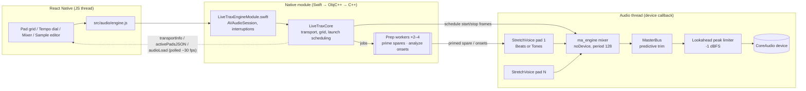

# Live Trax Audio Engine, Phase 1: CPU, DSP and Time-Stretch

> **Repository:** https://github.com/Kalyan5252/DSP_LIVE
> **Scope:** the native iOS engine in `live-trax/modules/live-trax-engine/ios/cpp/` (`LiveTraxCore.mm`, `analysis_core.h`, `resample_core.h`), plus the test harnesses in `live-trax/tools/`
> **History covered:** 2026‑09‑05 (`10fd8b9`, "Transport migration to DSP Control") to 2026‑10‑19 (`84d687e`, merge of PR #18 "audio-efficiency-quality")
> **Written:** 2026‑10‑19. Numbers marked *re-measured* were re-run on an Apple M2 for this document; the rest are quoted from the code comments and commit messages that recorded them.

---

## Table of Contents

1. [TL;DR](#1-tldr)
2. [What Phase 1 had to deliver](#2-what-phase-1-had-to-deliver)
3. [Architecture at a glance](#3-architecture-at-a-glance)
4. [Timeline: how the engine got here](#4-timeline-how-the-engine-got-here)
5. [The CPU story](#5-the-cpu-story)
6. [Time-stretch: how the streaming voice works](#6-time-stretch-how-the-streaming-voice-works)
7. [Beats mode: the Phase 1 tempo engine](#7-beats-mode-the-phase-1-tempo-engine)
8. [The rest of the DSP chain](#8-the-rest-of-the-dsp-chain)
9. [Threading and real-time safety](#9-threading-and-real-time-safety)
10. [Verification: harnesses and results](#10-verification-harnesses-and-results)
11. [Lessons learned](#11-lessons-learned)
12. [Known limits and the Phase 2 handoff](#12-known-limits-and-the-phase-2-handoff)
13. [Glossary](#13-glossary)
14. [Reference map](#14-reference-map)

---

## 1. TL;DR

Live Trax is a Remixlive-style loop instrument: a grid of pads, each holding a loop, all locked to one master tempo and launched on the bar. Phase 1 made that work in real time on an iPhone, with no CPU dropouts and no clicks.

**What fixed the CPU problems**, roughly in order of impact:

| # | Fix | Effect (measured) |
|---|---|---|
| 1 | Build the DSP at `-O2` even in Debug, and refuse to compile otherwise | 22× cheaper per voice (6.14% → 0.28% of a core). This alone explained "the dev build throttles" |
| 2 | **Beats mode**: play drum slices at 1× instead of phase-vocoding them | 8 pads: 0.2% vs 6.1% of real time |
| 3 | Pre-prime a **spare stretcher** off the audio thread before each quantized launch | 8-pad launch on one bar: 175% of the deadline (dropout) → a pointer flip |
| 4 | Several prep workers at user-interactive QoS | 3 of 8 row pads primed inside the callback (101%) → 0 overruns |
| 5 | `splitComputation` in Signalsmith | Worst callback with 8 voices: 40% → 11% |
| 6 | Signalsmith FFT on Apple Accelerate (vDSP) | 8 stretchers: avg 6.6% / max 14.8% → 5.6% / 9.6% |
| 7 | Resample once at load, not live per voice. Add fast paths for steady gain, the idle limiter and Beats slice bodies | 16 Beats pads, 44.1 kHz loops: callback avg 622 µs → 152 µs |

**How time-stretch works:** each pad is a custom `ma_data_source` (`StretchVoice`) that streams its loop through a Signalsmith stretcher at `ratio = masterBpm / loopBpm`. Tempo changes are live, with no restart and no buffer swap. The beat grid is kept in musical time (quarter notes), so it stays continuous across tempo changes. Each voice repays the stretcher's latency debt gradually so it stays on the grid.

**What ships in Phase 1:** every pad plays **Beats** (slice playback). The phase-vocoder path (**Tones**) is fully built and tested but switched off by one flag (`beatsOnly`) until Phase 2. It smears drum hits (pre-echo −1.6 dB vs −36 dB unstretched), and on an M2 it costs 20–30× what Beats costs (§10.3).

**Status:** `engine_test` 108/108, `pro_audio_test` 93/93, ThreadSanitizer clean, 0 heap operations on the audio thread across a full session, and 0 overruns on the real CoreAudio device. All re-measured.

---

## 2. What Phase 1 had to deliver

From `docs/TIME_STRETCH_PLAN.md` and `docs/SYNC_PLAN.md`:

1. **Per-sample tempo awareness:** every loop knows its own BPM and time signature.
2. **Master-tempo lock:** every loop plays at the master BPM with its pitch preserved.
3. **Beat-synced launch:** a tapped pad starts on the next grid boundary and drops in *at the phase it would be at* if it had been playing all along, so a column switch is seamless.
4. **Live tempo:** dragging the tempo dial must not stop, click, or knock anything off the grid.
5. **Real-time safety on a phone**, with many pads at once.

### The tempo math

```
ratio (engine)   r = masterBpm / loopBpm × rateScale      // input frames read per output frame
length factor      = 1 / r = loopBpm / masterBpm          // what the plan calls "stretchRatio"
clamped to         0.25 ≤ r ≤ 4.0                          // covers a 70 bpm loop in a 160 bpm set (2.29×)
```

The time signature never enters the ratio. It only sets bar length, the launch quantum and the UI grid:

```
framesPerQn   = sampleRate × 60 / masterBpm
qnPerBeat     = 4 / denominator             // /4 → 1, /8 → 0.5
quantumQn     = quantizeBeats × qnPerBeat   // e.g. 4 beats of 4/4 = 4 qn = 1 bar
```

`rateScale` is 1 except for a loop that was sample-rate-converted at load (§8.2). It corrects for that loop's length having been rounded to a whole frame, so the loop keeps the file's exact duration.

---

## 3. Architecture at a glance



Key design decisions:

- **One clock.** The master transport is miniaudio's own sample counter (`ma_engine_get_time_in_pcm_frames`). Launches and stops are scheduled with `ma_sound_set_start_time_in_pcm_frames` and `..._stop_time_...`. JS only reads the clock for the UI and is never the source of timing. This replaced a JavaScript `setInterval` transport, which jittered by milliseconds.
- **Device-less mixer.** The `ma_engine` runs with `noDevice`, and our own device callback pulls from it and then runs the master bus. The mixer survives device rebuilds, such as after an interruption or a media-services reset.
- **Everything heavy happens off the audio thread:** decoding, resampling, loudness measurement, transient analysis and stretcher priming.

---

## 4. Timeline: how the engine got here

| Date | Commit | Change | Why it mattered |
|---|---|---|---|
| 09‑05 | `10fd8b9` | Native transport + Signalsmith voice, real-time stretch | First end-to-end engine |
| 09‑07 | `83f45cd` | Master soft-clip (tanh) limiter | Many loops summed past 0 dBFS |
| 09‑07 | `9b622c0` | **Bypass the stretcher at native tempo + `presetCheaper`** | First CPU attempt (§5.3) |
| 09‑07 | `b854085` `c58fa2c` `0bae30a` | **Offline pre-render** of every loop to the master tempo, with buffer swap on the audio thread | Second CPU attempt (§5.4) |
| 09‑07–09 | `f423262` → `30e5fce` | `analysis_core.h`: BPM detection + transient markers on import | Each loop's base tempo |
| 09‑09 | `9f2b63c` | **CPU meter** + `stretch_test` harness | Started measuring instead of guessing |
| 09‑09 | `60e0fb8` `6e34c47` | Render worker off the JS thread; warp only when the tempo gesture ends | 1 s frozen UI; 1040 clicks per drag |
| 09‑09 | `5545ce0` | Podspec `-O2`; rotate renders by the stretcher latency | 22× Debug penalty; 125–185 ms flams |
| 10‑07 | `a42c2b8` | **Rewrite: one persistent streaming stretcher per voice**, no bypass, no render, no swap; grid lag-debt; spare stretcher; `#error` on `-O0`; `engine_test`; TSan | Removed every seam (§5.5) |
| 10‑07 | `47fcc19` | **Beats mode** (slice playback) + percussive auto-classification | Exact transients, ~0 CPU |
| 10‑07 | `fd0aa92` `f96793a` | Row swipe as one group launch/stop; quantized stop/cancel | No pad a bar late |
| 10‑10 | `0fc4b97` | Accelerate FFT; multi-worker priming at QoS; tempo seqlock; `pro_audio_test` | Launch spikes, grid drift |
| 10‑11 | `a8ea3a0` `1c3f5bb` | Lookahead peak limiter + auto-level; **`beatsOnly` (Phase 1 = Beats)** | Clean loudness; ship decision |
| 10‑18 | `2ec9f28` | −14 LUFS, band-limited SRC at load, predictive master bus, fast paths | "Flat" sound; 3.5× cheaper Beats |

---

## 5. The CPU story

### 5.1 First, measure on the audio thread

JS-side timing cannot see the audio thread, so "CPU throttling" was not actionable until the engine measured itself. `AudioLoadMeter` (`LiveTraxCore.mm` L926) times every device callback, including the mix and the master bus, against its deadline:

```
load = time spent in callback / (frameCount / sampleRate)     // 1.0 = whole budget used = dropout
```

It publishes a ~1 s EMA, the peak since the last read, an overrun count, and diagnostics: callback size, device rate, voice count, and whether the DSP was compiled optimized. `src/components/CpuMeter.js` shows it in the transport bar (`avg% pk% ovr N  8v 256f@48k`) and turns red on any overrun, a peak ≥ 100%, or an unoptimized build.

`tools/stretch_test` added the key insight about *how* to read stretcher cost. A block-based stretcher does its work on hop boundaries, so most callbacks cost nothing and every Nth callback does everything. The median reads 0.001 ms and means nothing. What matters is the **sustained core%** (total time over total audio) and the **p99/max single-callback time**, because that is what causes a dropout.

The first measurement settled where to look. Across 8 voices the engine's per-sample glue cost 0.006 ms per callback and the stretcher cost 0.243 ms, so **the stretcher was ~97% of audio-thread CPU**.

### 5.2 The stretcher choice

Signalsmith Stretch was chosen over Rubber Band (GPL or paid), SoundTouch (LGPL, awkward with static linking on iOS) and Superpowered (commercial SDK). It is MIT, high quality, controls time and pitch independently, and has a `splitComputation` mode built for real-time use (`docs/TIME_STRETCH_PLAN.md` §2). See `signalsmith-stretch-analysis.md` in this repo for how the algorithm itself works.

### 5.3 Attempt 1: bypass at native tempo + cheaper preset (`9b622c0`), abandoned

The idea: when `|r − 1| < 0.01`, copy the PCM straight through and skip the stretcher. Also switch to `presetCheaper`.

Why it was abandoned:
- Every bypass ↔ stretch transition needed a `stretch.reset()`, and each transition was an audible seam. Engaging a stretch reloads its pipeline, so the sound changes.
- When `stretch_test` later measured the cheaper preset, it scored **43.2** on the loop-seam metric (seam discontinuity vs the signal's own 95th-percentile delta; < 1 is good), against 1.37 for `presetDefault`. That is a large discontinuity at the loop wrap.

### 5.4 Attempt 2: offline pre-render (`b854085` → `5545ce0`), abandoned

The idea was Phase 1 of the original plan: render each loop to the master tempo *once* into a new RAM buffer, then play it at ratio 1, which costs almost nothing. Three problems turned up, and each was fixed before the approach was dropped:

| Problem | Measured | Fix at the time |
|---|---|---|
| Rendering ran synchronously on the JS thread | ~120 ms per pad, ~1 s of frozen UI per tempo settle | Background render worker; requests coalesce so only the newest tempo survives |
| `applyTempo()` re-fired on every pause in a tempo drag, and each re-render reset the stretcher | **1040 clicks** across one gesture (~37 resets) vs +6 for one reset | Warp only when the gesture ends |
| A rendered loop started `inputLatency/rate + outputLatency` late, and that offset depends on the loop's original tempo | 125 ms (90 bpm source) vs 185 ms (174 bpm), so loops flammed after the first warp | Rotate the circular render back by exactly that offset (0.0 ms residual) |

The fatal flaw was structural. Live tempo is either impossible (wait for a render) or needs a switch between buffers, and **every switch was an audible fade or click**. The tempo dial could never be a performance control.

### 5.5 The rewrite: one persistent streaming stretcher per voice (`a42c2b8`)

This is the approach zplane's élastique uses. Each voice owns one stereo stretcher, fed block by block, and a tempo change is just a new factor for the next block. **There is no bypass, no offline render and no buffer swap, so there is no seam anywhere.** At ratio 1.0 the stretcher is transparent (−127 dB vs the latency-aligned input), so a bypass would buy nothing.

That made the stretcher's cost permanent, so the rest of this section is about making it cheap and making it *smooth*.

### 5.6 The biggest single win: the DSP was running at `-O0`

Xcode's Debug configuration compiles C/C++ at `-O0`. For a phase vocoder + FFT + per-sample loops that is a **22× penalty**: 6.14% of a core per voice vs 0.28% at `-O2`. With 8 pads that is ~50% of the deadline instead of ~2%. Later measurements put it at 132% vs 6.5% (8 pads), and the device crackled.

The fix came in three layers, because the first one silently failed:

1. **Podspec:** `s.compiler_flags = '-O2'` (`5545ce0`, 9 Sep). Clang honours the last `-O` flag it sees, so this overrides Debug's `-O0`.
2. **The trap:** CocoaPods only applies podspec edits after `pod install`. The flag added on 9 Sep never reached the Xcode project, so **every Debug build ran the DSP at `-O0` until the guard below landed on 7 Oct**.
3. **The guard** (`a42c2b8`), at the top of `LiveTraxCore.mm`:
   ```cpp
   #if !defined(__OPTIMIZE__) && !defined(LTX_ALLOW_UNOPTIMIZED)
   #error "LiveTraxCore must be built with -O2: run `pod install` after editing LiveTraxEngine.podspec"
   #endif
   ```
   The CPU meter also reports `optimized` and shows `UNOPTIMIZED` in red. The test suite deliberately links once at `-O0` (`LTX_ALLOW_UNOPTIMIZED`) to catch symbols that `-O2` inlines away.

### 5.7 FFT on Accelerate, and `splitComputation`

- **`SIGNALSMITH_USE_ACCELERATE=1`** (podspec + vendored `signalsmith-linear/platform/fft-accelerate.h`) runs Signalsmith's FFT on vDSP. With 8 stretchers on an M2 the callback went from avg 6.6% / max 14.8% to **5.6% / 9.6%**, with output identical up to float rounding.
- **`presetDefault(channels, sampleRate, /*splitComputation*/ true)`** (L1420) spreads each hop's FFT work across callbacks. The worst case with 8 voices went from **40% → 11%** of a callback, at the same quality as the default preset.

### 5.8 Launch spikes: the spare stretcher and the prep workers

Steady-state cost was fine; launches were not. A quantized launch has to **prime** the stretcher so its next output sample is the input at the grid position. This is élastique's `PreFillData`, done with Signalsmith's `outputSeek()`. Priming costs ~20% of a callback per pad. When 8 pads launch on one downbeat, one callback spiked to **175%**, which is a dropout.

**Fix 1: a double-buffered stretcher per voice** (L195):

```
stretchers[2], act ∈ {0,1}           // audio thread plays stretchers[act]
spareState: Free → Priming → Ready → Taken → Free
launchToken                          // bumped by every triggerSync; stale spares are recycled
```

A quantized launch queues a prime job. A prep worker primes the *spare* at the exact launch position and ratio, then marks it `Ready`. On the downbeat the audio thread does one `compare_exchange` and flips `act` (L440–451). The spare is used only if its token and position match this exact launch. Otherwise it is marked stale and the worker recycles it.

**Fix 2: enough workers, at the right priority** (`0fc4b97`, L979–1090). A launch can be as little as 20 ms ahead, and a spare that isn't ready by then gets primed inside the callback. One worker priming a row of 8 serially missed that window: 3 of 8 pads were primed in the callback, at **101%** of the deadline. A launch could also wait behind a whole-file analysis after a project opened. Now:

- 2–4 workers (`hardware_concurrency / 2`, clamped) at `QOS_CLASS_USER_INTERACTIVE`.
- Prime jobs always run first. At most one analysis job runs at a time, and it drops to `QOS_CLASS_UTILITY`.
- An instant launch (first pad, quantize Off) primes on the JS thread (~1 ms) rather than in the callback.

Re-measured on the real device (`pro_audio_test` P6, M2): 8 pads launched at once peaks at 40.1%, against a steady 8-pad peak of 40.5%. The launch now costs nothing extra.

### 5.9 Trimming the engine around the stretcher

| Change | Where | Why |
|---|---|---|
| `MA_SOUND_FLAG_NO_SPATIALIZATION \| MA_SOUND_FLAG_NO_PITCH` | L1432 | The 3D spatializer was a pass-through that still ran per pad per callback. Tempo is the stretcher's job, not miniaudio's pitch node |
| `periodSizeInFrames = 128` | L1175 | Bounds how far miniaudio reads ahead of the playhead. Matters for sync (§6.3) at negligible CPU |
| Resample at load, not live | L1402, `resample_core.h` | Removes a resampler per voice from every callback, and fixes the dull top end (§8.2) |
| Gain applied *after* the stretcher, one vector multiply when steady | L682–716 | A mixer move is heard at once instead of ~150 ms later; no per-sample ramp math when nothing moves |
| Limiter `idleBlock()` fast path | L798 | When no gain reduction is pending, the limiter reduces to a delay line. The result is bit-identical |
| Beats `straightRun()` memcpy | L398, L555 | Inside a slice body the output *is* the source, so copy it in one go (§7.4) |

Result (`2ec9f28`): 16 Beats pads with 44.1 kHz loops, **callback avg 622 µs → 152 µs**; hot engine read 65 µs → 18.5 µs. All outputs are bit-identical.

### 5.10 The decisive one: don't stretch drums at all

Even optimized, the phase vocoder is the expensive part, and it is also what made drums sound soft (§7.1). Beats mode plays slices at 1× and runs no FFT. With 8 pads it costs **0.2% vs 6.1%** of real time. That is why Phase 1 ships Beats on every pad (§6.5).

---

## 6. Time-stretch: how the streaming voice works

The Tones path is built, tested and ready for Phase 2. Beats (§7) reuses its grid and sync machinery, so this section matters for both.

### 6.1 The voice

`StretchVoice` (L88) is a custom `ma_data_source`, miniaudio's official extension point, with its own `read` / `seek` vtable. It holds:

- the decoded loop, interleaved f32, **immutable after load** (so any region is always in bounds);
- tempo atomics (`baseBpm0`, `masterBpmA`) under a seqlock;
- edit parameters as atomics: region, gain, channel gain, master gain, auto-level, fades, play mode;
- two stretchers plus pre-allocated scratch, sized for `kMaxRatio` so nothing allocates later.

### 6.2 Feeding the stretcher: priming and the fractional carry

The Tones path in `voice_read` (L626–680) works like this:

```
if needPrime: primeStretcher(at = inPos)      // outputSeek: the next output IS the input at inPos
for each block (≤ 1024 output frames):
    pay   = clamp(lagDebt, ±6% of block × r)  // see 6.3
    want  = block × r + pay + inCarry
    inNeed = floor(want); inCarry = want − inNeed   // carry the fraction to the next block
    feed inNeed frames (loop wrap, fades, one-shot tail of silence)
    stretch.process(in, inNeed, out, block)
```

Two details that each fixed a measured bug:

- **`inCarry`**: rounding each block's input count on its own made the read rate drift ~3 ms per loop against the grid.
- **Pre-roll = `outputSeekLength(r)`** = `inputLatency + r × outputLatency`. A primed stretcher emits the input it was primed at first, so the voice's read position runs exactly that far ahead of what is *heard*. The UI playhead (`playPos`) subtracts it (L672–679), so the highlight matches the audio.

### 6.3 Live tempo without losing the grid

A tempo change raises three separate timing problems, and each needed its own fix:

**(a) The grid itself.** Deriving bar positions from "frames since origin × new tempo" re-reads the whole history at the new tempo. After a single 120 → 140 change, launches were **0.8 beats off**. The grid is now kept in musical time, anchored at an engine frame (L1096–1162):

```cpp
qnAt(f)      = anchorQn + (f − anchorFrame) / framesPerQn()
rebaseGrid() { n = now(); anchorQn = qnAt(n); anchorFrame = n; }   // called BEFORE masterBpm changes
```

**(b) The stretcher's pipeline.** The stretcher holds `outputLatency` samples that were read at the old ratio, so after a change the heard position is off by `(rNew − rOld) × outputLatency` input frames. That is 31 ms for 120 → 90. The voice records this as `lagDebt` and pays it back by reading up to **6% more or less input per block**. It converges well under a second and is too gentle to hear as a tempo change. It is never a jump (L637–651).

**(c) miniaudio's read-ahead.** miniaudio reads a voice ahead of the playhead, so by the time a tempo change reaches it the voice has already produced some frames at the old ratio. For a 48 kHz file that is a constant 128 frames and the error cancels out. For a resampled file (a 44.1 kHz pack on a 48 kHz device) it varies, and the error **random-walked to 2.5–5 ms off the grid after 30 changes in 10 minutes**. Now `setMasterTempo` stamps each voice with the voice frame where the change takes effect (`tempoAt`, published with the tempo under a seqlock). The audio thread computes `late = outCount − tempoAt` and repays exactly what it over-read (L123–144, L464–468).

`P7` in `pro_audio_test` covers this: 10 minutes, 8 pads, Tones + Beats, 44.1/48 kHz, odd lengths, 30 tempo moves, **drift 0**.

### 6.4 Phase-locked, quantized launch

`launchVoice` (L1533) starts a loop at the position it *would* be at had it been playing since the grid origin:

```
loopQn   = regionLen / (fileRate × rateScale) × loopBpm / 60     // loop length in quarter notes
phase    = fmod(qnAt(startAt), loopQn)
inStart  = regionStart + regionLen × phase / loopQn   (+ fractional frame in pendingFrac)
```

- **The loop's length in quarter notes uses the loop's own sample rate.** Using engine frames put a 44.1 kHz loop on a 48 kHz engine **354 ms off**.
- **The fractional frame is kept** (`pendingFrac`). Without it, the same loop stacked on several pads ran 0–1 frame apart, which acts as a comb filter that dulls the top end.
- **Near-integer snapping:** a grid position of 4999.9999996 used to read one frame early forever.
- **`nextBoundary()`** (L1202) is the next multiple of the quantum at least 20 ms ahead, so a launch is never scheduled in the past.
- **"Fresh" launch:** if nothing else is sounding, this launch defines the grid origin and plays now. Otherwise it waits for the boundary.
- **Row swipe = one event** (`triggerSyncMany`, `stopSyncMany`). It makes one freshness decision and uses one shared start frame. Calling `triggerSync` per pad let the first pad define the grid, and the rest waited a whole extra bar.

### 6.5 Why Phase 1 ships Beats only

```cpp
// LiveTraxCore.mm L223–226
// Phase 1: every pad is a Beats pad -- whatever the loop, its column, an
// explicit Tones request (older saved projects) or analysis still running.
// Tones (the time-stretcher) is phase 2; this switch turns it back on.
std::atomic<bool> beatsOnly{true};
```

Three reasons:
1. **Sound.** A phase vocoder smears a hit's energy up to ~40 ms *ahead* of it. A kick slowed from 120 to 92 bpm measured **pre-echo at −1.6 dB vs −36 dB** unstretched, which is why stretched kicks and snares sounded soft and lost in a mix.
2. **CPU headroom on phones.** Re-measured on an M2, 8 Tones pads peak at ~40% of the real device's deadline, and the README budgets 2–3× that on an older iPhone. Beats stays around 1–4% (§10.3).
3. **Risk.** The Tones → Beats switching path, Auto classification and the editor control all exist and are tested. Shipping one path first means one sound and one cost model to support.

The UI already reflects this: `SampleEditor.js` and `config.js` note that every pad plays Beats for now and the column is only a hint.

---

## 7. Beats mode: the Phase 1 tempo engine

Beats is the approach behind Ableton's "Beats" warp mode and REX slicing: **never stretch a hit.** Each transient-to-transient segment plays at 1× from its onset, placed on the same grid-locked playhead the stretcher would use.

### 7.1 Finding the hits (`analysis_core.h`, `detectTransients`, L486)

It runs once per load on a prep worker, at utility QoS:

1. Per-1 ms energy of the high-passed signal (first difference) and of the full band.
2. Rise ratio R = HF energy in the next 10 ms over the 20 ms before (with a 2 ms gap). Skip anything below −60 dB, and skip frames where the full-band level is falling (that is a decay, not an attack).
3. Peaks with R ≥ **8 dB** are candidates. Each one is placed at the first 0.5 ms block whose HF energy is 8 dB over the preceding 10 ms, then moved **1.5 ms earlier** so a slice never clips its own attack.
4. Minimum spacing is **30 ms**, and position 0 is always a slice.

The detector it replaced measured relative to its own peak. It invented **105 slices in a held chord** and found only 3 of 6 ghost tabla strokes, and its full-band refinement locked onto ring tails up to 15 ms early.

**Percussive score** (`percussiveScore`, L588) is the fraction of segment length in which the level falls ≥ 15 dB below its peak before the next hit. Drums score ~1; pads, chords and held bass score ~0. The score drives Auto (≥ 0.7 percussive, ≤ 0.3 tonal). Under `beatsOnly` it is only reported.

### 7.2 Playing slices on the grid

Per output frame, with `H` = the heard source position advancing at the grid-locked ratio `r` (L493–623):

```
if H left the current slice: look up slice [on[i], on[i+1]) containing H
    segOut = (H − sliceStart) / r          // as if the slice had started on its onset
src = sliceStart + segOut                  // the slice plays at 1× from its onset
out = orig[src] × fades
H += r ; segOut += 1
```

So the *position* of every hit follows the master tempo exactly, while the *audio* of each hit is the original, bit-exact.

### 7.3 Edges: seams, fades and the sustain fill

- **Speeding up** (r > 1): the next hit arrives before the slice has finished. The slice is cut with a **3 ms fade-out**, and the next one eases in over 1 ms. The ease-in never touches the attack, because onsets sit 1.5 ms ahead of it.
- **At the loop's own tempo**, slices run straight into each other and are detected as **seamless**, so no fades are applied. Fading every boundary on a dense hi-hat loop had cost 1.4 dB and taken the attacks off.
- **Slowing down** (r < 1): a slice runs out before the next hit. Left silent, that was a hole in every slice, **10% of the time at 0.88×, 18% at 0.75×**, measured on real tabla loops and heard as chopping. Now the **sustain fill** loops the slice's last ≤ 40 ms with a 10 ms equal-power crossfade, decaying at the slope measured across that tail. A ringing stroke rings on into the next one (L529–547, L566–584).
- **Mode switches** (Tones ↔ Beats) continue from the *heard* position, compensating the stretcher's lag, and ramp the new path in over 5 ms.

### 7.4 Straight runs

Inside a slice body nothing fades, fills or slews, so the output *is* the source. `straightRun()` computes, conservatively by one frame at each bound, how many frames the slow path would output as plain source, and `memcpy`s them. `H` and `segOut` still advance frame by frame, so every later decision sees exactly the numbers the per-frame path would have. The output is bit-identical and about 5× cheaper per voice.

---

## 8. The rest of the DSP chain

### 8.1 Decoding (L1232–1327)

miniaudio handles WAV, AIFF, MP3 and FLAC. **ExtAudioFile** handles everything else iOS can play: M4A/AAC, ALAC, CAF and ADTS. Before the fallback existed, those files "imported" and then played a silent pad. After decoding, **NaN/Inf are zeroed** (one NaN would poison the stretcher's state for good and reach the speakers as full-scale pops) and values are clamped to ±16 (+24 dBFS).

### 8.2 Band-limited sample-rate conversion, once (`resample_core.h`)

Most packs, and Logic's default, are 44.1 kHz, while iPhones run at 48 kHz. miniaudio converted those live with linear interpolation and no anti-alias filter, at the cost of a resampler per voice per callback. Now conversion happens once at load with a **Kaiser-windowed sinc** (110 dB stopband, passband to 20 kHz). It is linear-phase and centred, so nothing moves in time, and it runs circularly for loops so the seam stays seamless. The dot product uses `vDSP_dotpr`.

| 44.1 kHz multitone through a 48 kHz engine | live linear (before) | sinc at load (*re-measured*) |
|---|---|---|
| 15 kHz / 20 kHz | −3.4 / −6.3 dB | +0.00 / +0.00 dB |
| worst spur / image | 12 dB under the music | 131.2 dB under |
| cost | per voice, every callback | 12.5 ms once, for an 8.2 s stereo loop |

### 8.3 Auto-level (L59–71, L1438–1453)

Every pad is measured at load with **ITU-R BS.1770-4 integrated loudness** (K-weighting, 400 ms blocks, −70 / −10 LU gates), over two loop passes because a loop is heard repeating. It is then gain-matched to **−14 LUFS**, the level streaming apps play at on the same phone.

- The target was −23 LUFS (EBU R128). That left every pad 13–14 dB under its own file and ~9 dB under any music app: the "flat, lifeless" sound. Headroom for big stacks is now the master bus's job.
- Boost is capped at **+12 dB**, so quiet FX are not blown up.
- A pad's peak is never pushed past the limiter's ceiling. A 0 dBFS hats loop had been held 2.3 dB down by the limiter even when playing alone.

### 8.4 Master bus: predict, don't react (L878–916)

Each playing voice reports its file's measured loudness (as power) and its sample peak, times its gains, once per callback. The bus **predicts** the mix:

- **Loudness:** uncorrelated loops add as power. If more than one pad is playing and the sum exceeds **−12 LUFS**, the whole stack is trimmed, like pulling the master fader down. Every pad moves by the same amount, so the balance holds.
- **Peak:** drum loops on the same grid add coherently (6 grid-aligned loops peaked ~3 dB over the RSS of their peaks). The predicted peak is the geometric mean of RSS and plain sum, which matched measured stacks within ~1 dB. The bus trims so it lands at most 1 dB over the limiter ceiling.
- The trim falls over **30 ms** and recovers over **300 ms**, and it only moves when a pad starts or stops or a fader moves, never with the music. **It cannot pump.**

### 8.5 Lookahead peak limiter (L751–856)

It is a safety net after the bus: stereo-linked, **5 ms lookahead**, a **100 ms hold** of the minimum required gain (a monotonic-deque sliding minimum), **500 ms release**, a 5 ms box-smoothed gain, and a ceiling of **−1 dBFS** for codec and Bluetooth headroom. The hold covers the smoothing window, so the ceiling is never exceeded. The tanh soft-clipper it replaced bent every sample above 0.8, measuring 29% distortion with 4 loud pads and 37% with 8; this limiter measures 1.9% / 4.2%, all of it slow level movement. A NaN guard means a bad sample can't become a +1.0 pop.

### 8.6 Declicking every edge the engine makes (L47–57)

| Edge | Ramp |
|---|---|
| Stop (immediate or quantized): the fade ends exactly on the stop frame | 5 ms |
| Launch mid-waveform (joining a running mix at its grid phase) | 2 ms. Never at a loop top or a detected onset, which start from ~0, so attacks stay bit-exact |
| Trimmed region edges, a one-shot's end | 2 ms |
| Editor gain, mixer volume / mute / solo, master volume | 5 ms linear |
| One-shot outro in Tones (window smear past the content) | one stretcher latency |

Removing a playing pad fades it first and parks the voice in a **graveyard** that is reaped on later JS calls. `pro_audio_test` P1–P3 cover these edges. Transitions that used to show 12–35× steps (vs a smooth signal's own sample-to-sample step) now pass; a hard stop and a mid-loop launch measure 1.00×.

### 8.7 Tempo analysis on import (`analysis_core.h`)

Tempo sources, most trustworthy first: **the tempo the exporting DAW wrote into the file** → a "120bpm" in the file name → detection, tie-broken by the project tempo. The detection pipeline is a Hann STFT (2048/512) → spectral-flux onset envelope → autocorrelation → candidate scoring (harmonic comb, onset alignment, loop plausibility, range prior) → explicit octave and 3:2 resolution → beat phase. A real pack loop (12 beats at 88 bpm, Logic "Tempo: 88.0") had been detected as 16 beats at 117.33 and drifted ~1 s in 16 s against its own pack. Metadata-first fixed it (`engine_test` R18).

---

## 9. Threading and real-time safety

| Thread | Runs | Rules |
|---|---|---|
| **Audio** (device callback) | mixer, `voice_read`, master bus, limiter, load meter | No allocation, locks or I/O. It reads atomics; it flips a primed spare but never primes one |
| **JS** | the `LiveTraxCore` API: load, launch scheduling, tempo, edits, UI readouts | Writes atomics or seqlocked values; `padsMtx` guards only the map's structure |
| **Prep workers** (2–4) | prime spares (user-interactive QoS), onset analysis (utility QoS, one at a time) | Hold voices by `shared_ptr` so an unload mid-prime can't free one |
| **AVAudioSession notifier** | resume after an interruption; rebuild the device after a media-services reset | Serialized by `deviceMtx`; the mixer is device-less, so pads and grid survive |

Lock-free handoffs worth knowing:
- **Tempo seqlock** (`publishTempo` / `readTempo`): base BPM, master BPM and `tempoAt` are read as one consistent snapshot. A torn read retries up to 3× and then falls back without read-ahead correction for that one block.
- **Spare state machine** (`Free → Priming → Ready → Taken`) with `launchToken`, so a superseded prime is never used.
- **Onsets:** `onsetBuf` is sized at load and written once by the worker, then published with a release store of `onsetCount`.
- **Region:** start and end are two atomic stores. `region()` tolerates seeing them apart, and because the source buffer never changes size, no combination can read out of bounds.

All three are verified: `make tsan` reports 0 warnings, and P5 hooks libmalloc plus C++ `new`/`delete` and counts **0 heap operations on the audio thread** across 1853 callbacks and 13 performance actions (*re-measured*).

---

## 10. Verification: harnesses and results

Every harness compiles the **shipping** C++ unmodified on a Mac and measures rendered audio, so a regression shows up as a number. No Xcode or device rebuild is needed.

### 10.1 The harnesses

| Harness | What it proves |
|---|---|
| `tools/tempo_test` | BPM and onset accuracy against generated ground truth (`make bench`): tempo hit rate, onset F1, marker timing, beat phase |
| `tools/stretch_test` | Cost and damage of a stretch backend: sustained core%, p95/p99/max per callback, structure / sharpness / spectral distance / loop seam, and clicks during a ratio *sweep* |
| `tools/engine_test` | `engine_test` (R1–R18 + declick): sync, tempo, decode, interruptions, Beats, row swipe, real pack loops. Sync suites run in both Tones and Beats |
| | `pro_audio_test` (P1–P12): every transition's click, gain-smoothing latency, hostile files, audio-thread heap use, real-device callback load, a 10-minute drift test, 48-pad memory, 20–300 bpm extremes, stacking and loudness |
| | `quality_bench`: renders, SRC quality, paced callback CPU |
| | `tsan_test`: audio thread vs JS calls vs prep workers |

### 10.2 Results (*re-measured* 2026‑10‑19, Apple M2)

```
engine_test      108 passed, 0 failed
pro_audio_test    93 passed, 0 failed
P5               1853 callbacks / 13 performance actions: 0 heap operations on the audio thread
```

**P6: callback load on the real CoreAudio device (8 pads, Tones path):**

| Workflow | Peak load | Overruns |
|---|---|---|
| idle | 0.3% | 0 |
| steady: 8 pads stretching | 40.5% | 0 |
| 8 pads launched at once (row swipe) | 40.1% | 0 |
| 8 columns switched on one bar | 41.2% | 0 |
| tempo dial dragged (30 moves, 30 ms apart) | 41.5% | 0 |
| Stop All + relaunch the row | 42.6% | 0 |
| mixer: 8 faders + mute/solo | 33.2% | 0 |

The worst workflow spike is 1.05× the steady peak, inside the suite's < 1.4× limit. Before the spare and worker fixes, this table had a 175% row and a 101% row.

### 10.3 Beats vs Tones cost (*re-measured*, `quality_bench cpu`, paced like a device, 10 ms deadline)

| Pads | Beats avg / p99 | Tones avg / p99 |
|---|---|---|
| 1 | 0.18% / 0.47% | 4.1% / 7.4% |
| 4 | 0.66% / 1.45% | 14.4% / 28.6% |
| 8 | 0.79% / 2.07% | 23.1% / 53.0% |
| 16 | 1.12% / 3.33% | — |

(48 kHz loops; 44.1 kHz loops are within noise of these, now that conversion happens at load.)

> **Note on the numbers.** The code comments quote "8 voices ≈ 6% of the deadline" for Tones. That figure came from an earlier, differently paced measurement. Today's paced bench puts 8 Tones voices at ~23% average, ~53% p99. Use the paced numbers for Phase 2 planning; either way Tones costs about 20–30× what Beats costs.

---

## 11. Lessons learned

1. **Measure on the audio thread, on the device, with p99 and max.** Medians lie for block-based DSP. The CPU meter turned "it throttles" into a number.
2. **Check the build before the algorithm.** The largest single CPU fix was a compiler flag that silently never applied. A `#error` is cheaper than a month of `-O0` profiling.
3. **Every mode switch is a seam.** Bypass, render and buffer-swap each saved CPU and each cost a click. The steady design runs one path, always, and makes that path cheap.
4. **Move spikes off the deadline.** Pre-priming spares turned a 175% downbeat into a pointer flip. Background work needs enough workers at the right QoS, and expensive analysis must never block a launch.
5. **Keep musical time.** The grid in quarter notes, a fractional carry between blocks, the fractional launch frame, latency-debt repayment and the read-ahead stamp each fixed a measured drift of 0.3 ms to 354 ms.
6. **Don't use DSP where none is needed.** Drums don't need a phase vocoder. Slices are exact, and they are almost free.
7. **Predict the mix instead of reacting to it.** Loudness-aware trim plus a transparent safety limiter replaced a clipper that distorted and a limiter that pumped.

---

## 12. Known limits and the Phase 2 handoff

**Open items, tracked as `KNOWN` lines in the suites (they report but never fail):**
- Switching a *playing* pad Beats → Tones re-primes inside the callback (peak 51% vs steady 42%). Switching 8 at once through the API peaks at ~96–100%; the UI only switches one at a time.
- A quantized relaunch of a pad that is already sounding shows a 31.8× step at the call.
- The engine clamps the ratio to 0.25–4.0. A 120 bpm loop in a 20 bpm set (0.167) plays at 0.25 and drifts off the grid.
- Raw ADTS AAC reads 118.42 bpm because of encoder padding; a loop with no metadata and no hint can be genuinely ambiguous (117.33 vs 88).
- **Android:** the Expo module on Android is still the template stub. Phase 1 is iOS only.

**Phase 2: turning Tones back on.**
1. Set `beatsOnly = false` (engine `Impl::beatsOnly` and the voice flag) and expose the existing Auto / Beats / Tones control in the sample editor. Auto already sends clearly tonal loops (held pads, chords) to Tones and everything else to Beats.
2. Budget CPU against the paced numbers in §10.3, assuming 2–3× on older iPhones. Candidates: cap concurrent Tones voices, choose a per-voice preset (default for a featured loop, a cheaper one for the rest; the cheap preset's loop seam needs fixing first), and prime the spare off-thread when switching modes as well as at launch.
3. Re-run P6 and P7 on device builds with the in-app CPU meter. The M2 is the optimistic case.
4. Later: per-pad pitch shift (semitones; the stretcher already supports it), warp markers for loops that aren't trimmed to whole bars, swing.

---

## 13. Glossary

| Term | Meaning |
|---|---|
| **Beats / Tones** | The two tempo paths: slice playback at 1× (Beats) or a phase-vocoder time-stretch (Tones) |
| **Callback load** | Time spent in one audio callback ÷ its deadline. ≥ 1.0 is a dropout (an "overrun") |
| **Grid / quantum** | The master beat grid in quarter notes; the quantum is how many beats a launch waits for (Off, 1/4 … 8) |
| **Lag / pre-roll** | How far a voice's read position runs ahead of what is heard: `inputLatency + r × outputLatency` |
| **Lag debt** | Input frames a voice still owes the grid after a tempo change, repaid at ≤ 6% per block |
| **LUFS** | Loudness units relative to full scale (ITU-R BS.1770) |
| **Phase-locked launch** | Starting a loop at the phase it would have if it had been playing since the grid origin |
| **Priming** | Pre-filling a stretcher (`outputSeek`) so its next output is exactly a chosen input position |
| **Spare** | The second stretcher per voice, primed off-thread for an upcoming launch |
| **Split computation** | Signalsmith option that spreads each hop's FFT work over several callbacks |
| **Sustain fill** | Looping the tail of a Beats slice when slowing down, so there are no silent holes |

---

## 14. Reference map

`LiveTraxCore.mm` (in `live-trax/modules/live-trax-engine/ios/cpp/`), at commit `84d687e`:

| Lines | What |
|---|---|
| L1–9 | `-O2` compile guard |
| L40–71 | Ratio bounds, declick lengths, loudness targets |
| L88–326 | `StretchVoice`: tempo seqlock (L120–144), lag debt (L178), double stretchers (L195), spare states (L202), Beats state + `beatsOnly` (L213–262) |
| L332–392 | `FeedParams`, `feedFrame`, `primeStretcher` |
| L398–419 | `straightRun` (Beats fast path) |
| L422–720 | `voice_read`: launch + spare flip (L427–452), Beats (L493–623), Tones (L626–680), output stage (L682–719) |
| L751–856 | `MasterLimiter` |
| L858–917 | `MasterBus` (predictive trim) |
| L919–963 | `AudioLoadMeter`, device callback |
| L979–1090 | Prep workers, `primeSpare`, `analyzeVoice` |
| L1092–1209 | Musical-time grid, `initEngine`, `nextBoundary` |
| L1232–1327 | Decoding + NaN scrub |
| L1391–1465 | `loadPad`: SRC, preset, flags, loudness, analysis job |
| L1533–1658 | `launchVoice`, `triggerSync(Many)`, `stopSync(Many)`, `cancelStop` |
| L1668–1691 | `setMasterTempo`, `setPadBpm`, `applyTempo` (no-op) |
| L1727–1736 | `analyzeSample` (metadata → filename → detection) |
| L1766–1788 | `audioLoad` readouts for the CPU meter |

Other files:
- `analysis_core.h`: `analyzeMono` L206, `readEmbeddedTempo` L412, `detectTransients` L486, `integratedLufs` L548, `percussiveScore` L588
- `resample_core.h`: `resampleSinc` L50
- `ios/LiveTraxEngine.podspec`: `-O2`, `SIGNALSMITH_USE_ACCELERATE`
- `src/components/CpuMeter.js`: the on-device load readout
- `docs/TIME_STRETCH_PLAN.md`, `docs/SYNC_PLAN.md`, `docs/CPP_INTEGRATION_PLAN.md`: the original plans
- `tools/engine_test/README.md`: the full R/P test tables with before/after values
- In this repo: `signalsmith-stretch-analysis.md` (the stretcher's internals) and `adaptive-multiresolution-pv-analysis.md` (transient-quality research for Phase 2)
