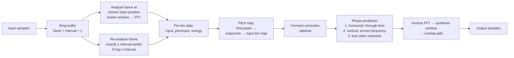

# Signalsmith Stretch — Technical Analysis

> **Repository:** https://github.com/Signalsmith-Audio/signalsmith-stretch
> **Version analysed:** `1.3.2` (header constant), commit `a670068` (2026‑09‑25), depending on Signalsmith Linear `0.6.4`
> **License:** MIT, so you can use it commercially with attribution
> **Analysed on:** 2026‑10‑10, Apple M2, Apple clang 21

---

## Table of Contents

1. [What "stretch" means](#1-what-stretch-means)
2. [Repository at a glance](#2-repository-at-a-glance)
3. [The big picture: how the engine works](#3-the-big-picture-how-the-engine-works)
4. [Step-by-step procedure (with code references)](#4-step-by-step-procedure-with-code-references)
5. [Pitch shifting in detail](#5-pitch-shifting-in-detail)
6. [Time stretching in detail](#6-time-stretching-in-detail)
7. [Formant handling](#7-formant-handling)
8. [Real-time engineering: latency, split computation, silence](#8-real-time-engineering-latency-split-computation-silence)
9. [Measured CPU cost (benchmarks)](#9-measured-cpu-cost-benchmarks)
10. [Public API cheat-sheet](#10-public-api-cheat-sheet)
11. [Strengths and limitations](#11-strengths-and-limitations)
12. [Competitive landscape (vs. zplane élastique and others)](#12-competitive-landscape-vs-zplane-élastique-and-others)
13. [Roadmap: building a world-class engine on this base](#13-roadmap-building-a-world-class-engine-on-this-base)
14. [Glossary](#14-glossary)

---

## 1. What "stretch" means

Audio stretching covers two related operations:

| Operation | What changes | What stays the same | Example |
|---|---|---|---|
| **Time-stretching** | Duration / tempo | Pitch | Slow a 120 BPM loop to 100 BPM without it sounding lower |
| **Pitch-shifting** | Pitch | Duration | Transpose a vocal up 3 semitones while keeping it in time |
| **Formant shifting** | Timbre ("vocal tract size") | Pitch and duration | Make a voice sound larger or smaller without changing the note |

Naive approaches fail:
- **Playing faster or slower (resampling)** changes pitch and duration together, like a tape machine.
- **Cutting and splicing in the time domain** (OLA, WSOLA, PSOLA) works well for single voices but causes phasing and echo on polyphonic material.
- **A basic phase vocoder** (FFT, then adjust phases, then inverse FFT) handles polyphony, but it sounds "phasey" and "underwater" and smears drum hits. This is called **phase incoherence**.

Signalsmith Stretch is a **phase-vocoder-family** algorithm. Its contribution is a better way to **predict output phases**. It combines predictions across time and across frequency, which keeps partials coherent and transients sharp without explicit transient detection.

The algorithm is the fourth and final method from Geraint Luff's ADC22 talk, *"Four Ways To Write A Pitch-Shifter"*.

---

## 2. Repository at a glance

```
signalsmith-stretch/
├── signalsmith-stretch.h                 ← THE ENTIRE ALGORITHM (1,060 lines, header-only, C++11)
├── include/signalsmith-stretch/…h        ← 1-line forwarding header (for CMake include paths)
├── CMakeLists.txt                        ← INTERFACE target; FetchContent pulls signalsmith-linear 0.6.4
├── cmd/
│   ├── main.cpp                          ← CLI example: WAV in → stretched WAV out (shows full API)
│   ├── main-dev.cpp                      ← Dev build with per-step profiling hooks + memory tracker
│   ├── Makefile / CMakeLists.txt         ← Builds with -O3 and Apple Accelerate
│   └── util/ (git submodule)             ← WAV I/O, arg parsing, stopwatch
└── web/
    ├── emscripten/main.cpp, compile.sh   ← C exports → WASM (-O3 -ffast-math, single file)
    ├── web-wrapper.js                    ← AudioWorkletProcessor + AudioWorkletNode API
    ├── release/                          ← NPM package "signalsmith-stretch" (.js + .mjs)
    └── demo/                             ← Interactive browser demo
```

**Dependency: [Signalsmith Linear](https://github.com/Signalsmith-Audio/linear)**, by the same author. It provides:
- `DynamicSTFT`: STFT with separate analysis and synthesis windows, self-normalising overlap-add, ring-buffered I/O, and step-wise ("chunked") computation.
- FFTs in sizes of 2ⁿ × {1…6, 8}, with optional back-ends: **Apple Accelerate**, **Intel IPP**, **PFFFT**, and CMSIS-DSP for ARM microcontrollers.

**Ecosystem:** a Python binding (`python-stretch`, used by default in *Audiomentations*), a Rust crate (`signalsmith-stretch`), and the official WASM/NPM release.

---

## 3. The big picture: how the engine works



**Core idea in one sentence:** the output runs on a fixed grid of hops (every `interval` samples). At each hop, the engine picks where in the input to read a spectrum, and it synthesises phases so each output partial continues smoothly from the previous output frame. Phases also stay consistent with neighbouring frequencies, which keeps transients sharp, and with other channels, which keeps the stereo image.

### Default parameters

| Preset | Block (window) | Interval (hop) | Overlap | FFT size @ 48 kHz | Bins | Bin spacing |
|---|---|---|---|---|---|---|
| `presetDefault` | 120 ms (5760) | 30 ms (1440) | 4× | 6144 | 3072 | ≈ 7.8 Hz |
| `presetCheaper` | 100 ms (4800) | 40 ms (1920) | 2.5× | — (next fast size) | — | — |

The FFT is zero-padded up to the next "fast" size (`SplitFFT::fastSizeAbove`). It uses the **modified (half-bin-shifted) real FFT**, so bin `b` is centred at `(b + 0.5)/N`. This means no bin sits on DC or Nyquist, which avoids special cases at the band edges.

---

## 4. Step-by-step procedure (with code references)

All line numbers refer to `signalsmith-stretch.h`.

### Step 0 — Configure (`configure()`, L71)
- `stft.configure(channels, channels, blockSamples, intervalSamples + 1)`: the extra input history (interval + 1 samples) lets the engine **re-analyse a frame exactly one hop in the past**. This is essential for Step 3.
- A **Kaiser window** is chosen for the block-to-interval bandwidth ratio (`stft.setInterval(interval, stft.kaiser)`), and Linear forces perfect reconstruction.
- All buffers are allocated here. `process()` then runs **without heap allocation**: every `resize` call stays within the reserved capacity.

### Step 1 — Silence detection (`process()`, L231–278)
- The engine sums input energy. If it stays below `1e‑15` for more than 2 blocks, it **bypasses the whole spectral engine**: it copies input to output and clears phase state. This saves CPU during silence and gives a clean restart.

### Step 2 — Decide when to compute a new spectrum (L280–319)
- The output is produced one sample at a time. Every `interval` output samples, a new block is due.
- The input position is mapped linearly: `inputOffset = round(outputIndex × inputSamples / outputSamples)`.
- **`timeFactor = interval / inputInterval`** is the local stretch ratio, which can change on every block. This is how time-stretch automation works.
- The engine counts how many "steps" the block needs: analysis, spectrum processing, and synthesis. These steps can be spread over time (see §8).

### Step 3 — Analysis (two frames)
1. If the input hop was not equal to `interval` (±1 sample), the engine **re-analyses the previous frame exactly one interval before the current read position** (`reanalysePrev`, L303). It then stores that spectrum in `Band::prevInput`.
2. It analyses the current frame into `Band::input`.

> **Why this matters:** each bin's phase change between `prevInput` and `input` is then measured over exactly one interval, the same distance as the output hop. The measured "instantaneous frequency" is therefore always correct, whatever the stretch ratio. Classic phase vocoders scale phase increments by the stretch ratio, which is where much of their phasiness comes from. This design avoids that.

### Step 4 — Rotate stored phases (`processSpectrum`, L642–658)
- Each bin's `output` and `prevInput` are rotated by that bin's nominal centre-frequency advance over one interval. After this, the phase twist measured on the input automatically becomes the right advance for the **output** frequency, even when the output bin reads from a different, fractional input bin (pitch shift). The bin-offset terms cancel exactly.

### Step 5 — Build the frequency map (only when pitch-shifting; see §5)
- `smoothEnergy` → `findPeaks` → `updateOutputMap`. The result is `outputMap[b] = {inputBin, freqGrad}`.
- If there is no pitch shift, the map is the identity.

### Step 6 — Formant correction (optional; see §7)

### Step 7 — Preliminary prediction: through time (L697–719)
For each output bin `b` in each channel:
```
prediction.energy = interp(inputEnergy at inputBin) × freqGrad
prediction.input  = interp(input at inputBin)
freqTwist         = input × conj(prevInput)        // phase advance over 1 interval
output[b]         = prevOutput[b] × freqTwist      // continue the partial
```
This is the classic phase-vocoder estimate. It continues each partial from where it was.

### Step 8 — Main prediction: across frequency (L722–803) ★ the key innovation
For each bin, the engine takes the **loudest channel** and sums up to **four** phase predictions from neighbouring output bins:

| Neighbour | Distance | State at that time |
|---|---|---|
| `b − 1` | short step | already final (sweep goes upward) |
| `b − longStep` | `≈ fftSize/interval` bins (≈ 4) | already final |
| `b + 1` | short step | still preliminary (from Step 7) |
| `b + longStep` | long step | still preliminary |

Each neighbour's phase is "twisted" by the **input's phase difference between bins `timeFactor` apart**:
```
shortVerticalTwist = input(inputBin) × conj(input(inputBin − timeFactor))
phase += neighbourOutput × shortVerticalTwist
```

> **Intuition:** the slope of phase against frequency encodes **where in time** energy sits inside a frame, for example where a drum hit lands. Measuring that slope across `timeFactor` input bins scales the time offsets by the stretch ratio. A transient therefore stays a sharp, coherent click in the output, without a transient detector. Horizontal (time) and vertical (frequency) coherence are blended automatically, weighted by energy.

- **Large stretches (> 2×):** `timeFactor` is randomised per bin, uniformly in `[4 − T, T]` (`maxCleanStretch = 2`). This adds controlled phase decorrelation, which avoids the metallic sound that perfectly coherent phases produce under extreme stretching.
- **Magnitude:** `makeOutput()` keeps only the **direction** of the predicted phase and sets the magnitude to `sqrt(prediction.energy)`. If the prediction is too weak, it falls back to the input phase.

### Step 9 — Multichannel phase locking (L790–800)
Non-loudest channels take the loudest channel's output phase plus their **original inter-channel phase difference** (`input_c × conj(input_max)`). This **preserves the stereo image** and mid/side compatibility, which is a common failure in naive per-channel vocoders.

### Step 10 — Synthesis
Each spectrum goes through the inverse FFT, then the synthesis window, then overlap-add into the output ring buffer. Linear's `DynamicSTFT` normalises by the accumulated window products, so the output reconstructs correctly for any window and hop.

### Step 11 — Start and end of fixed-length audio
- **`outputSeek()`** (L173): renders a pre-roll, then **negates it, time-reverses it, and adds it back**. This "reflected pre-roll" cancels the window fade-in, so sample 0 of the output lines up with sample 0 of the input.
- **`flush()`** (L427): the same reflection trick at the end, so there is no click and no truncated tail.
- **`exact()`** (L468): `outputSeek` + `process` + `flush` in one call, for offline processing with exact output length.

---

## 5. Pitch shifting in detail

Pitch shifting here **remaps spectral content in frequency**. It does not resample in time.

1. **Energy smoothing** (`smoothEnergy`, L818). The engine sums energy across channels, then smooths it with a one-pole filter run downward and then upward over about `fftSize/interval` bins. The result is a spectral "floor".
2. **Peak picking** (`findPeaks`, L859). Every contiguous run of bins whose energy is above the smoothed floor counts as one peak. The peak's position is the energy-weighted centroid, which gives sub-bin accuracy.
3. **Frequency mapping** (`mapFreq`, L850):
   - Below the **tonality limit**: `f_out = f × ratio`, a true harmonic transposition.
   - Above it: `f_out = f + (ratio − 1) × limit`, a constant **shift** rather than a multiply. This keeps noisy high frequencies (air, sibilance) from being spread or squeezed, so more of the original timbre survives. The CLI default limit is 8 kHz. The internal limit is `limit / sqrt(ratio)`, a compromise between input and output.
   - You can also pass any monotonic map with `setFreqMap(fn)`. This allows inharmonic effects and non-linear tunings.
4. **Output map** (`updateOutputMap`, L882). Each peak is moved exactly to its mapped frequency. Bins **between** peaks are interpolated with a smoothstep curve `h = r²(3 − 2r)`. Smoothstep has zero slope at both ends, so the **shape of each peak is translated rigidly** and does not get stretched. `freqGrad`, the local slope of the map, scales energy so total power is conserved.

**Result:** wide transpositions (the README says "multiple octaves") keep clean partials, because each partial is moved as a unit instead of having its bins smeared.

---

## 6. Time stretching in detail

- Time stretch is **implicit**: you pass more or fewer input samples than output samples to `process()`. There is no "ratio" setter. The ratio is simply `inputSamples / outputSamples`, measured at each hop.
- The output hop is fixed, and the input hop varies (`inputInterval`). The phase-advance measurement always spans exactly one interval (Step 3). The vertical twist scales intra-frame timing by `timeFactor` (Step 8).
- **Quality zone (README):** best between **0.75× and 1.5×**. Up to 2× it is clean. Beyond 2×, phase randomisation is applied deliberately. Compression below 0.5× is clamped (`timeFactor ≥ 1/maxCleanStretch`).
- **Automation:** feed rate and pitch values that belong to the *processing time*. That is `outputLatency()` ahead of the output you hear, with input supplied `inputLatency()` ahead of the processing time.

---

## 7. Formant handling

Formants are the resonances of the vocal tract or instrument body. Plain pitch shifting moves them too, which causes the "chipmunk" effect.

**Algorithm (`updateFormants`, L972):**
1. Sum the energy of all channels into `formantMetric`.
2. **Fundamental estimate.** Use the user's `setFormantBase(f0/sampleRate)`, or if it is 0, a *"VERY rough"* (author's words) pitch estimate from the 3 strongest peaks, smoothed over time.
3. **Spectral envelope** by morphological filtering:
   - Two passes of a **peak-hold (max) filter** with decay tied to f0. This bridges the gaps between harmonics.
   - Two passes of a **min filter** with the reciprocal decay. This pulls the envelope back down.
   - Together they form a "closing" operation that gives a smooth envelope over the harmonic peaks.
4. For each bin, compare the envelope at the bin with the envelope at the inverse-mapped formant frequency, then scale the bin energy by that ratio.
5. `compensatePitch = true` also undoes the pitch map on the envelope. This keeps the voice's character while its pitch changes.

**Note from the README:** this is less precise than monophonic methods such as PSOLA, but it works on polyphonic material.

---

## 8. Real-time engineering: latency, split computation, silence

### Latency (measured)

| Sample rate | Preset | Input latency | Output latency | **Total** |
|---|---|---|---|---|
| 44.1 / 48 / 96 kHz | `presetDefault` | 60 ms | 60 ms | **120 ms** |
| 44.1 / 48 / 96 kHz | `presetDefault` + split | 60 ms | 90 ms | **150 ms** |
| 44.1 / 48 / 96 kHz | `presetCheaper` (split on by default) | 50 ms | 90 ms | **140 ms** |

Latency is a **fixed amount of time**: block sizes scale with sample rate.
- **Input latency** = `block − analysisOffset`, which is half a block for the symmetric window.
- **Output latency** = `synthesisOffset`, plus one interval when split computation is on.

### Split computation (`splitComputation` flag)

Without it, the full spectral work (2–3 FFTs per channel and all bin processing) runs in **one audio callback per hop**, which produces CPU spikes. With it:
- The block's work is divided into numbered **steps**: analysis per channel, energy smoothing ×3, peak finding, map update, formants ×3, preliminary prediction per channel, **main prediction ×8 chunks**, and synthesis per channel.
- On each output sample, the engine runs the share of steps that matches its progress through the hop: `steps × (samplesSinceLast + 1) / interval`.
- Cost: **+1 interval of output latency** (+30 ms by default).
- Measured effect: **worst-case callback drops about 3–4×** (see §9), while average CPU is unchanged.

> **Limitation:** inside Stretch, the STFT is created with FFT-level splitting turned **off** (`DynamicSTFT<Sample, false, true>`). Each channel's FFT is therefore one indivisible step. For mono input, the biggest single step cannot be divided further. Linear supports split FFTs, so this is an easy improvement.

### Other real-time properties
- No allocation and no locks in `process()`. It is safe for the audio thread.
- Parameter setters are **not thread-safe** (no atomics). Call them from the audio thread, or wrap them in your own message queue.
- The I/O accessors are templated: anything where `buf[channel][index]` works can be used, such as interleaved wrappers or `OffsetIO` views. There are no copies.
- The RNG is a template parameter. A cheaper engine, such as `std::ranlux48_base` or a xorshift, can be plugged in.

---

## 9. Measured CPU cost (benchmarks)

**Setup:** Apple M2 (one core), `-O3`, stereo, 48 kHz, 30 s of a harmonic tone plus noise, 256-sample output callbacks. Source: [`bench/stretch-bench.cpp`](bench/stretch-bench.cpp).

| Configuration | Speed (built-in FFT) | Avg CPU per stream | Worst 256-sample callback | Speed (Accelerate) |
|---|---|---|---|---|
| default, 1.0×, no pitch | 138× realtime | 0.72 % | 0.30 ms (5.7 % of budget) | 150× |
| default, 1.25× stretch | 120× | 0.83 % | 0.43 ms (8.0 %) | 132× |
| default, +5 semitones | 119× | 0.84 % | 0.32 ms (6.0 %) | 128× |
| default, 1.25× and +5 st | 104× | 0.96 % | 0.47 ms (8.8 %) | 115× |
| default, +5 st, formant comp. | 90× | 1.11 % | 0.59 ms (11.0 %) | 97× |
| **default + split**, 1.25× and +5 st | 100× | 1.01 % | **0.14 ms (2.7 %)** | 112× |
| **cheaper** (split), 1.25× and +5 st | **151×** | **0.66 %** | **0.13 ms (2.5 %)** | **167×** |

**Takeaways**
- About **100–150 stereo streams per M2 core** in theory, by average CPU. Real-time capacity is limited by the worst callback, so split computation is what matters at high voice counts.
- Pitch shifting costs about 15 % (peak finding and map). Formants cost about 15 % more.
- The **Accelerate FFT back-end** gives about 8–11 %. The FFT is not the main cost. Most of the time goes to **scalar per-bin complex arithmetic** in `processSpectrum`. That is where optimisation should start (§13).
- Worst-case numbers come from a single run and are noisy. One Accelerate run had a 1.1 ms outlier, which is probably OS scheduling. Run several times for decisions.

To reproduce, clone `signalsmith-stretch` and `linear` (tag `0.6.4`) into this folder, then run:
```bash
clang++ -std=c++11 -O3 -DSIGNALSMITH_USE_ACCELERATE -framework Accelerate -I signalsmith-stretch/include -I linear/include bench/stretch-bench.cpp -o bench/stretch-bench
```

---

## 10. Public API cheat-sheet

```cpp
#include "signalsmith-stretch.h"
signalsmith::stretch::SignalsmithStretch<float> stretch;   // optional: <float, MyRNG>, or ctor(seed)

// --- Setup ---
stretch.presetDefault(channels, sampleRate);               // 120 ms / 30 ms
stretch.presetCheaper(channels, sampleRate);               // 100 ms / 40 ms, split on
stretch.configure(channels, blockSamples, intervalSamples, splitComputation);
stretch.reset();

// --- Pitch / formants ---
stretch.setTransposeSemitones(semis, tonalityLimit = 8000.0/sampleRate);
stretch.setTransposeFactor(ratio, tonalityLimit);
stretch.setFreqMap([](float f){ return f * 1.5f; });      // custom, monotonic, normalised freq
stretch.setFormantSemitones(semis, /*compensatePitch*/ true);
stretch.setFormantBase(200.0 / sampleRate);                // 0 = auto-detect

// --- Streaming ---
stretch.process(in, inSamples, out, outSamples);           // ratio = inSamples/outSamples
stretch.seek(in, stretch.seekLength(), playbackRate);      // jump in input, keep output continuous
stretch.flush(out, outSamples);                            // drain the tail at end of stream

// --- Offline / sample playback ---
stretch.outputSeek(in, stretch.outputSeekLength(rate));    // pre-roll so output starts exactly at input 0
stretch.exact(in, inSamples, out, outSamples);             // one-shot, exact-length render

// --- Introspection ---
stretch.inputLatency(); stretch.outputLatency();
stretch.blockSamples(); stretch.intervalSamples();
```

**Web (NPM `signalsmith-stretch`):** `SignalsmithStretch(audioContext)` returns an `AudioWorkletNode`. It provides `.addBuffers()`, `.schedule({input, rate, semitones, formantSemitones, loopStart, loopEnd, …})`, `.start()`, `.stop()`, and `.latency()`. `setFreqMap` is **not** exposed to the web build.

---

## 11. Strengths and limitations

### ✅ Strengths
| Area | Detail |
|---|---|
| **Algorithm quality** | Combined time and frequency phase prediction gives transient coherence without a detector. Peak-locked pitch mapping. Stereo phase locking. |
| **Wide pitch range** | Multi-octave transposition with tonality limit and custom maps |
| **Simplicity** | A single 1,060-line header plus a small dependency. Easy to audit, port, and fork. |
| **Licensing** | MIT, with no copyleft obligations (unlike Rubber Band's GPL tier) |
| **Real-time safety** | No allocation in `process()`, chunked CPU spreading, silence bypass |
| **Portability** | C++11, WASM/AudioWorklet, Python, Rust, ARM (CMSIS) back-ends |
| **Efficiency** | About 1 % of one M2 core per stereo stream |

### ⚠️ Limitations (opportunities)
| Area | Detail |
|---|---|
| **Stretch range** | Best between 0.75× and 1.5×. Beyond 2× it relies on phase randomisation, which adds diffuseness. |
| **Latency** | 120–150 ms. Too high for live monitoring or performance pitch-shifting. |
| **Single resolution** | One fixed window, so there is a time/frequency trade-off: bass wants long windows, drums want short ones. No multi-resolution or adaptive windowing. |
| **No explicit transient handling** | Coherence comes only from phase prediction. There is no transient detection, no phase reset, and no separate processing of transient and stationary parts. |
| **Formants** | Rough pitch estimator and a simple envelope. Weaker than LPC, cepstral, or neural envelopes for solo voice. |
| **No monophonic mode** | No PSOLA or time-domain engine for solo voice or instruments, where such engines usually win. |
| **Compute layout** | Array-of-structs `Band`, `std::complex`, branches, and RNG in the hot loop limit auto-vectorisation. No multithreading. |
| **Thread safety** | Setters are not atomic |
| **Test coverage** | No automated tests or objective quality metrics in the repo |

---

## 12. Competitive landscape (vs. zplane élastique and others)

> The competitor details below come from general public product knowledge, not from this analysis. Check vendor documentation before relying on them.

| Engine | Vendor / License | Approach (public info) | Positioning |
|---|---|---|---|
| **élastique Pro / Efficient / SOLOIST / Tune** | zplane, commercial SDK | Proprietary. Separate engines for polyphonic quality, low CPU, and monophonic voice. | Industry standard licensed in many DAWs and DJ apps. Strong at extreme ratios and transients. |
| **Rubber Band (R2 "Faster", R3 "Finer")** | Breakfast Quay, GPL or commercial | Phase vocoder. R3 adds multi-resolution analysis. | Widely used in open source and some commercial products |
| **Bungee** | Parabola Research, MPL‑2.0 | Phase vocoder ("Basic"), with a paid "Pro" tier | Modern, real-time-oriented, permissive core |
| **SoundTouch** | LGPL | WSOLA (time domain) | Low CPU and low latency, lower polyphonic quality |
| **Signalsmith Stretch** | MIT | Time and frequency phase prediction (this report) | Smallest and most permissive, high quality at modest ratios |

### Where Signalsmith already competes
- Polyphonic pitch shifting at moderate settings
- Licence freedom and code simplicity
- Per-stream efficiency

### Gaps to close before competing with zplane
1. **Extreme ratios** (0.25×–4× and beyond): ambient textures, DJ-style rate changes
2. **Drum and transient fidelity** at all ratios
3. **A low-latency mode** (< 30 ms)
4. **A dedicated monophonic/voice engine** with high-precision formant preservation
5. **Product tiers** (quality, efficiency, and solo modes) with predictable CPU budgets
6. **Validation**: published listening tests and objective metrics

---

## 13. Roadmap: building a world-class engine on this base

### Phase 1 — Performance (CPU scaling)
| # | Action | Expected gain | Grounded in code |
|---|---|---|---|
| 1.1 | Convert `Band` / `Prediction` from AoS to **SoA split-complex arrays** and vectorise Steps 7–8 with Linear's expression templates or SIMD | Large: this is the hot loop | `processSpectrum` L697–803 |
| 1.2 | Enable **FFT-level split computation** (`DynamicSTFT<Sample, true, …>`) | Flatter worst-case callback, especially for mono | L519 |
| 1.3 | Replace the `std::default_random_engine` + `uniform_real_distribution` call per bin with a cheap xorshift | Small to medium for >2× stretches | L749, L769 |
| 1.4 | Use **IPP, PFFFT, or Accelerate** back-ends by default per platform | ≈ 8–11 % (measured) | `SIGNALSMITH_USE_*` |
| 1.5 | Multithread across channels or tracks for offline rendering; batch-render long files in parallel chunks with overlap | Linear with cores | `exact()` |
| 1.6 | Skip vertical prediction for bins below the noise floor (energy gating) | Content-dependent | L722 |

### Phase 2 — Quality
| # | Action |
|---|---|
| 2.1 | **Transient detection** (spectral flux) with a phase reset or short-window path on onsets |
| 2.2 | **Multi-resolution STFT**: long windows for low frequencies, short ones for highs, crossfaded in bands |
| 2.3 | **Harmonic / percussive / residual separation**: stretch each component with a suitable method (PV for harmonics, time-domain for percussion, noise resynthesis for the residual) |
| 2.3b | One concrete design for 2.2 and 2.3 that reuses this engine as the phase master: [adaptive-multiresolution-pv-analysis.md](adaptive-multiresolution-pv-analysis.md) (Juillerat & Hirsbrunner, ICASSP 2017) |
| 2.4 | Better **extreme-stretch** handling: replace uniform phase randomisation with noise-shaped resynthesis of stationary content |
| 2.5 | Better **formant envelope**: cepstral or true-envelope (iterative cepstrum), and a real pitch tracker (YIN/pYIN) instead of the 3-peak heuristic |

### Phase 3 — Product engines (matching zplane's tiers)
| Engine | Base | Target |
|---|---|---|
| **Pro** (quality) | Stretch + Phase 2 | Studio and offline rendering, extreme ratios |
| **Efficient** | `presetCheaper` + Phase 1 SIMD | ≥ 300 streams per core, DJ and mobile |
| **Live / Low-latency** | **Asymmetric windows**, which Linear already supports through the `asymmetry` parameter of `setInterval` (Stretch passes 0 today) | < 30 ms latency |
| **Solo** (voice) | New PSOLA/TD-PSOLA engine with pitch tracking and formant preservation | Vocals, monophonic instruments |

### Phase 4 — Validation and tooling
- **Objective metrics:** ViSQOL or PEAQ-style ODG, transient-smearing measures (onset sharpness), log-spectral distance on reference test sets.
- **Subjective tests:** MUSHRA panels against élastique and Rubber Band at standard ratios (0.5, 0.8, 1.25, 2, 4×) and transpositions (±3, ±7, ±12 st).
- **Regression suite** (missing today): golden-file tests, CPU budgets enforced in CI, and fuzzing of parameter automation.
- **CPU tracking over time:** extend [`bench/stretch-bench.cpp`](bench/stretch-bench.cpp) into a CI benchmark that records realtime factor and worst-case callback per commit, on x86 (AVX2/AVX-512) and ARM (Apple, Android).

---

## 14. Glossary

| Term | Meaning |
|---|---|
| **STFT** | Short-Time Fourier Transform: a sequence of windowed FFT frames |
| **Block** | Window length of each frame (120 ms by default) |
| **Interval / hop** | Spacing between frames (30 ms by default) |
| **Bin / band** | One frequency slot of the FFT |
| **Phase vocoder** | Spectral method that changes time or pitch by controlling phase advance per bin |
| **Phase coherence** | Partials and transients keep consistent phase relationships. Without it you hear "phasiness". |
| **Horizontal prediction** | Continuing each bin's phase through time |
| **Vertical prediction** | Deriving a bin's phase from its neighbours in frequency, which preserves transient shape |
| **Tonality limit** | Frequency above which pitch shift becomes a constant offset rather than a ratio |
| **Formant** | Spectral envelope peak (resonance) that defines timbre or vowel identity |
| **Split computation** | Spreading one block's work across many audio callbacks to avoid CPU spikes |
| **Modified real FFT** | FFT with a half-bin frequency shift, so bins avoid DC and Nyquist |
| **OLA / WSOLA / PSOLA** | Time-domain overlap-add stretchers (Waveform-Similarity / Pitch-Synchronous variants) |
